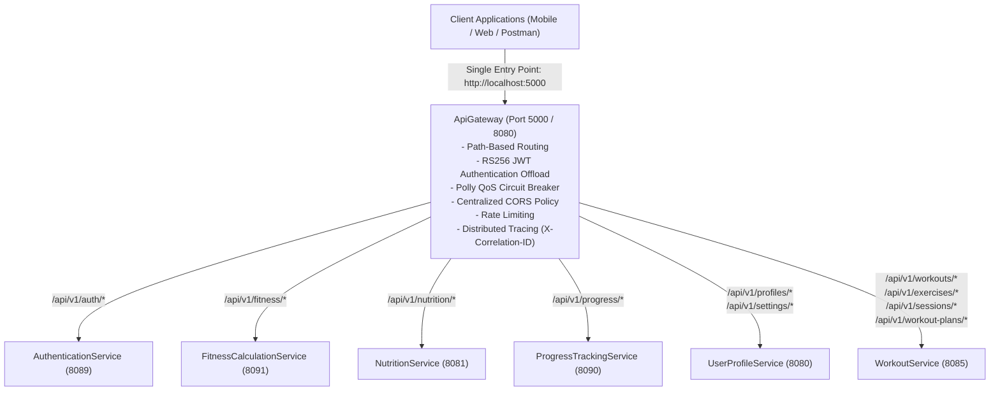

# Elevate Fitness — Standalone Ocelot API Gateway

> **Microservice:** `ApiGateway`  
> **Framework:** .NET 9.0 (ASP.NET Core Web API)  
> **Gateway Engine:** [Ocelot 23.4.3](https://github.com/ThreeMammals/Ocelot) with Polly Quality of Service  
> **Public Port:** `5000` (Local Dev) / `8080` (Container internal, mapped to `5000`)  
> **Security:** RS256 Asymmetric JWT Public Key Verification + Bearer Token Forwarding  

---

## 1. Overview & Architecture

The **ApiGateway** serves as the single, unified edge reverse-proxy for the Elevate Fitness microservice platform. Instead of clients (mobile apps, web apps) maintaining connections across 6 distinct ports, all external traffic enters through the Gateway at `http://localhost:5000`.



---

## 2. Route Mapping Matrix

| Route Identifier | Public Upstream Path | Downstream Service | Downstream Route | Auth Required |
| :--- | :--- | :--- | :--- | :---: |
| **Auth** | `/api/v1/auth/{everything}` | `AuthenticationService` | `/api/v1/auth/{everything}` | No (Public) |
| **Fitness** | `/api/v1/fitness/{everything}` | `FitnessCalculationService` | `/api/v1/fitness/{everything}` | Yes (`Bearer`) |
| **Nutrition** | `/api/v1/nutrition/{everything}` | `NutritionService` | `/api/v1/nutrition/{everything}` | Yes (`Bearer`) |
| **Progress** | `/api/v1/progress/{everything}` | `ProgressTrackingService` | `/api/v1/progress/{everything}` | Yes (`Bearer`) |
| **Profiles** | `/api/v1/profiles` & `/{everything}` | `UserProfileService` | `/api/v1/profiles` & `/{everything}` | Yes (`Bearer`) |
| **Settings** | `/api/v1/settings` & `/{everything}` | `UserProfileService` | `/api/v1/settings` & `/{everything}` | Yes (`Bearer`) |
| **Workouts** | `/api/v1/workouts` & `/{everything}` | `WorkoutService` | `/api/v1/workouts` & `/{everything}` | Yes (`Bearer`) |
| **Exercises** | `/api/v1/exercises` & `/{everything}` | `WorkoutService` | `/api/v1/exercises` & `/{everything}` | Yes (`Bearer`) |
| **Sessions** | `/api/v1/sessions` & `/{everything}` | `WorkoutService` | `/api/v1/sessions` & `/{everything}` | Yes (`Bearer`) |
| **Plans** | `/api/v1/workout-plans` & `/{everything}` | `WorkoutService` | `/api/v1/workout-plans` & `/{everything}` | Yes (`Bearer`) |

---

## 3. Dual-Environment Configuration

Ocelot configuration is split cleanly between local development and Docker:
* **`ocelot.Development.json`:** Routes requests to `localhost` host ports (`8089`, `8091`, `8081`, `8090`, `8080`, `8085`).
* **`ocelot.Docker.json`:** Routes requests to internal Docker container hostnames (`authenticationservice`, `fitnesscalculationservice`, etc.) on port `8080`.

---

## 4. Cross-Cutting Capabilities

### 4.1 RS256 JWT Authentication
* Protected routes specify `"AuthenticationProviderKey": "Bearer"`.
* The Gateway loads the RSA public key from `Keys/auth-service-public.pem` and validates token integrity and expiry before forwarding.
* The original token is forwarded downstream via `Authorization: Bearer <token>` for microservice-level ownership checks.

### 4.2 Quality of Service (QoS) & Circuit Breaker (Polly)
* Routes configure Polly QoS:
  * `ExceptionsAllowedBeforeBreaking: 3`
  * `DurationOfBreak: 10000 ms (10s)`
  * `TimeoutValue: 15000 ms (15s)`
* If a downstream service fails 3 times, the circuit breaker opens for 10 seconds to protect gateway threads.

### 4.3 Rate Limiting
* Configured per route (e.g. 15 req/s for Auth, 30 req/s for APIs).
* On quota exceeded, Ocelot returns HTTP 429 (`Too Many Requests`) with a `Retry-After` header.

### 4.4 Distributed Tracing
* Middleware generates or forwards `X-Correlation-ID` header across every request.
* Injected into Serilog log context for end-to-end distributed trace correlation.

---

## 5. Running the Gateway

### 5.1 Local Development
```bash
cd ApiGateway
dotnet run
```
Access the gateway root: `http://localhost:5000/` or health check: `http://localhost:5000/health`.

### 5.2 Docker Compose
```bash
docker compose up -d apigateway
```
Runs on port `5000:8080` with all backend dependencies orchestrated.
