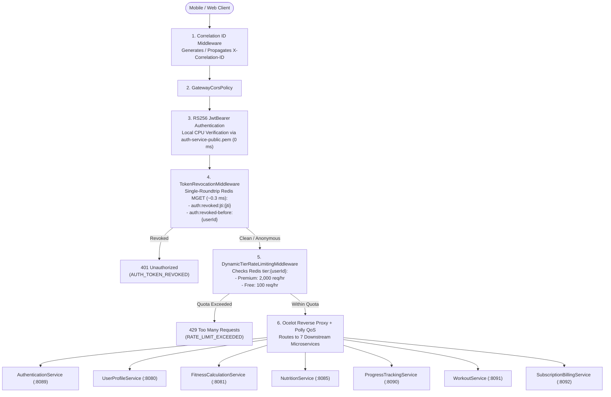

<div align="center">


# ApiGateway — Ocelot Reverse Proxy, Redis MGET Token Revocation & Dynamic Tier Rate Limiter

**The Unified Edge Security & Routing Layer for NextRep, Built with .NET 9, Ocelot 23.4, RS256 Public Key Cryptography, StackExchange.Redis, Polly Circuit Breakers, and Serilog Distributed Tracing**

</div>

---

## 1. Overview & Edge Pipeline Architecture

`ApiGateway` (Port `:5000`) is the single entry point for all external mobile and web traffic across the 7 domain microservices. Every incoming request traverses a deterministic, sub-millisecond security and observability pipeline before reaching any downstream service:



---

## 2. Custom Edge Middlewares

### 2.1 `TokenRevocationMiddleware` (`< 0.3 ms` Single-Roundtrip Redis `MGET`)
Located at [`Middleware/TokenRevocationMiddleware.cs`](./Middleware/TokenRevocationMiddleware.cs).
- Solves the "Zombie JWT" problem without ever calling `AuthenticationService` synchronously.
- Extracts `jti`, `sub` (`userId`), and `iat` (*Issued At* Unix timestamp) from the validated `ClaimsPrincipal`.
- Executes a single atomic Redis `MGET` (`IDatabase.StringGetAsync(RedisKey[])`):
  1. `auth:revoked:jti:{jti}` — set when a user logs out of a single device (`POST /api/v1/auth/logout`).
  2. `auth:revoked-before:{userId}` — set when a user clicks *Logout All Devices*, changes/resets their password, or triggers RFC 6819 Refresh Token Theft Detection.
- If `values[0].HasValue` OR (`values[1].HasValue` and `iat <= cutoffUnix`), the gateway short-circuits immediately with `401 Unauthorized` (`AUTH_TOKEN_REVOKED`).
- **Graceful Degradation (Fail-Open):** If the Redis container is temporarily unreachable, the middleware logs a structured warning and falls back to local RS256 signature + 15-minute `exp` validation.

### 2.2 `DynamicTierRateLimitingMiddleware` (`100` vs. `2,000 req/hr`)
Located at [`Middleware/DynamicTierRateLimitingMiddleware.cs`](./Middleware/DynamicTierRateLimitingMiddleware.cs).
- Reads the user's cached subscription tier (`tier:{userId}`) written by `SubscriptionBillingService`.
- Enforces hourly sliding-window counters (`rate:user:{userId}:{yyyyMMddHH}`):
  - **Free Users:** `100 requests / hour`
  - **Premium Subscribers:** `2,000 requests / hour`
- Emits `X-RateLimit-Limit`, `X-RateLimit-Remaining`, and `X-RateLimit-Tier` headers on every response.

---

## 3. Complete Route Mapping Matrix

| Upstream Gateway Path | Downstream Microservice | Container Port | Auth Required |
| :--- | :--- | :---: | :---: |
| `/api/v1/auth/{everything}` | `AuthenticationService` | `:8089` / `:8080` | Public / Bearer |
| `/api/v1/profiles/{everything}` & `/api/v1/settings/{everything}` | `UserProfileService` | `:8080` | `Bearer` |
| `/api/v1/fitness/{everything}` | `FitnessCalculationService` | `:8081` / `:8080` | `Bearer` |
| `/api/v1/nutrition/{everything}` | `NutritionService` | `:8085` / `:8080` | `Bearer` |
| `/api/v1/progress/{everything}` | `ProgressTrackingService` | `:8090` / `:8080` | `Bearer` |
| `/api/v1/workouts/*`, `/api/v1/exercises/*`, `/api/v1/sessions/*`, `/api/v1/workout-plans/*` | `WorkoutService` | `:8091` / `:8080` | `Bearer` |
| `/api/v1/subscription/webhooks/paymob` | `SubscriptionBillingService` | `:8092` / `:8080` | Public (HMAC-SHA512) |
| `/api/v1/subscription/{everything}` | `SubscriptionBillingService` | `:8092` / `:8080` | `Bearer` |

---

## 4. Running & Testing Locally

```bash
# Run the 5 unit tests for TokenRevocationMiddleware (NSubstitute + xUnit)
dotnet test ApiGateway/ApiGateway.csproj -c Release
```
