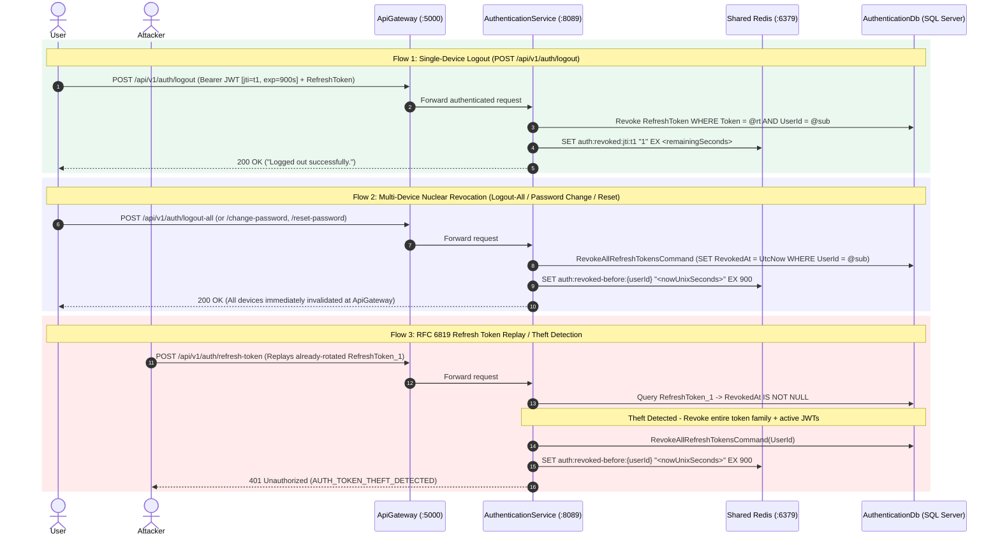
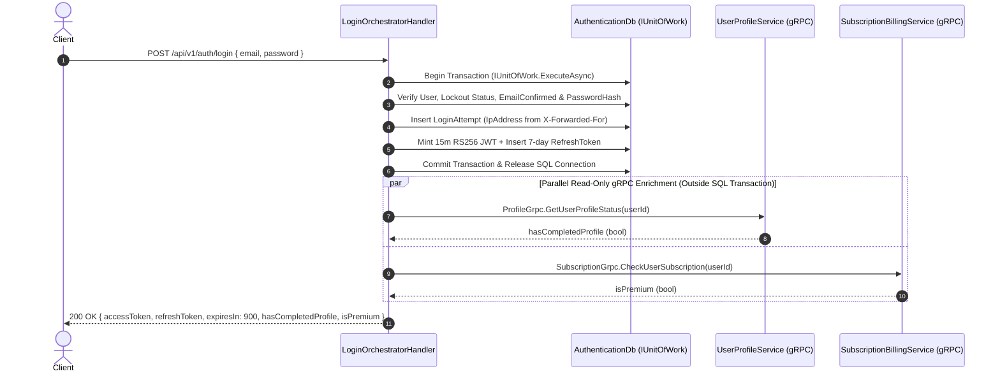
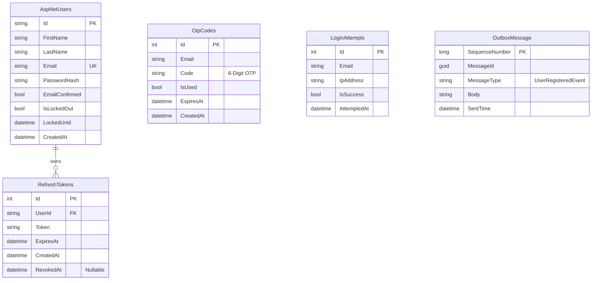

<div align="center">


# AuthenticationService — Identity, RS256 Cryptography & Hybrid Token Revocation Engine

**The Central Identity Provider for NextRep, Built with .NET 9, ASP.NET Core Identity, CQRS + MediatR, RS256 Asymmetric JWTs, Redis Denylists, RFC 6819 Refresh Token Theft Detection, gRPC, and MassTransit Transactional Outbox**

</div>

---

## 1. Overview & Core Responsibilities

`AuthenticationService` (Port `:8089`) is the authoritative security boundary for user identity, credential management, and cryptographic token issuance across the platform:

- **RS256 Asymmetric JWT Issuance (`15-Minute TTL`):** Mints compact, cryptographically signed JWTs using a 2048-bit RSA Private Key (`auth-service-private.pem`) with explicit `sub`, `email`, `jti`, and `iat` claims. Downstream microservices and `ApiGateway` verify tokens locally in `0 ms` using the read-only RSA Public Key (`auth-service-public.pem`).
- **Instant Single-Device & Multi-Device Token Revocation (Redis):** Implements [`ITokenRevocationStore`](./Services/ITokenRevocationStore.cs) and [`RedisTokenRevocationStore`](./Services/RedisTokenRevocationStore.cs) to blacklist individual access tokens (`auth:revoked:jti:{jti}`) on single-device logout and enforce user-wide timestamp cutoffs (`auth:revoked-before:{userId}`) on `logout-all`, password change, password reset, or refresh token theft detection.
- **RFC 6819 Refresh Token Rotation & Reuse/Theft Detection:** Rotates 7-day Refresh Tokens on every use and detects replay of already-revoked tokens, automatically locking down the user's account by revoking all SQL refresh tokens and active Redis JWTs.
- **Hardened 2-Step OTP Flow & Brute-Force Protection:** Enforces a maximum of **5 failed verification attempts** per OTP (`auth:otp-attempts:{email}`) and supports both 1-step and 2-step (`/verify-otp` $\rightarrow$ `/reset-password`) flows via one-time Redis verification markers.
- **Lock-Free Parallel gRPC Login Enrichment:** Queries `UserProfileService` (`HasCompletedProfileAsync`) and `SubscriptionBillingService` (`IsPremiumUserAsync`) concurrently via `Task.WhenAll` **outside** the SQL Server transaction boundary so database locks are never held during network I/O.
- **Transactional Outbox Event Publishing:** Publishes `UserRegisteredEvent` via MassTransit EF Core Outbox within the same SQL transaction as user creation.

---

## 2. Internal Architecture & Security Flows

### 2.1 Hybrid Token Revocation & RFC 6819 Theft Detection Sequence



---

### 2.2 Login Flow with Decoupled Parallel gRPC Enrichment



---

## 3. Database Schema (`AuthenticationDb`)



---

## 4. Complete REST API Reference

Base Route: `/api/v1/auth`

| Method | Endpoint | Auth | Request Body | Description |
| :---: | :--- | :---: | :--- | :--- |
| `POST` | `/register` | Public | `{ firstName, lastName, email, password }` | Registers user, generates 6-digit OTP, and publishes `UserRegisteredEvent` via Outbox. |
| `POST` | `/send-otp` | Public | `{ email }` | Issues a new 10-minute 6-digit OTP (rate-limited per email). |
| `POST` | `/verify-otp` | Public | `{ email, otp }` | Validates OTP (max 5 failed attempts), confirms email, and caches a 10-min Redis reset marker. |
| `POST` | `/login` | Public | `{ email, password }` | Authenticates user, enforces 5-strike lockout, mints 15m RS256 JWT + 7d Refresh Token, and enriches via gRPC. |
| `POST` | `/refresh-token` | Public | `{ refreshToken }` | Rotates Refresh Token and issues a new JWT. Triggers RFC 6819 lockdown if a revoked token is replayed. |
| `POST` | `/forgot-password` | Public | `{ email }` | Dispatches a password-reset OTP to the user's email. |
| `POST` | `/reset-password` | Public | `{ email, otp, newPassword }` | Resets password (supports both 1-step OTP and 2-step `/verify-otp` flow), revokes all SQL refresh tokens, and sets Redis user cutoff. |
| `POST` | `/change-password` | `Bearer` | `{ oldPassword, newPassword }` | Changes password for authenticated user, revokes all active refresh tokens, and sets Redis user cutoff. |
| `POST` | `/logout` | `Bearer` | `{ refreshToken }` | Verifies refresh token ownership (`UserId`), revokes it in SQL, and blacklists the caller's JWT `jti` in Redis. |
| `POST` | `/logout-all` | `Bearer` | *(Empty)* | Revokes all active Refresh Tokens in SQL Server and writes `auth:revoked-before:{userId}` in Redis. |
| `POST` | `/validate-token` | Public | `{ token }` | Validates RS256 signature, issuer, audience, lifetime, AND checks Redis `jti` + user cutoff denylists. |

---

## 5. Running & Testing Locally

```bash
# Run the 12 unit tests in AuthenticationService (auto-generates ephemeral RSA keys in CI via TestRsaKeyHelper)
dotnet test AuthenticationService/AuthenticationService.csproj -c Release
```
