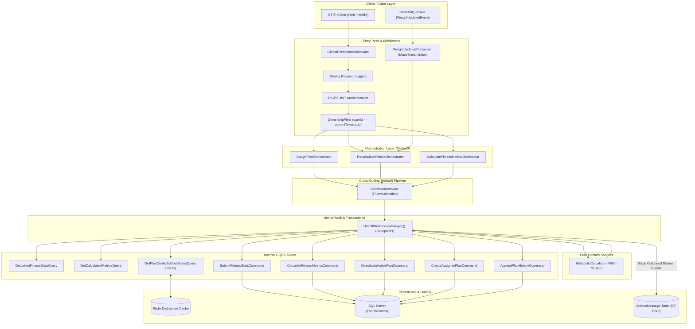
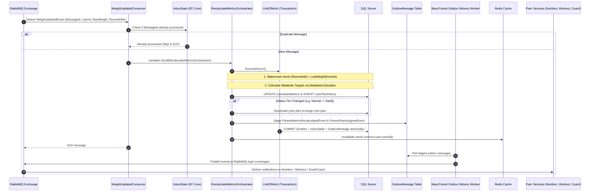
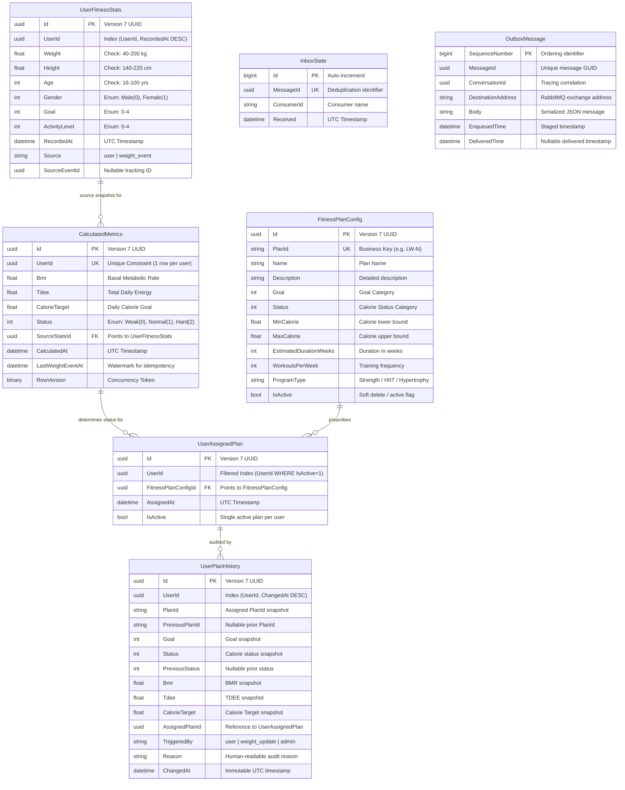
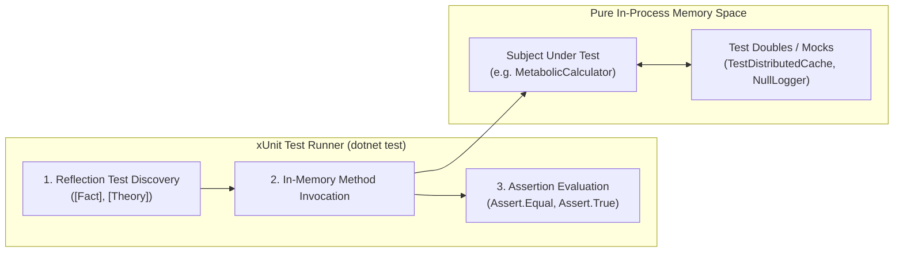

# Fitness Calculation Engine (FCE) — Architecture & Business Guide

> **Microservice:** `FitnessCalculationService`  
> **Framework:** .NET 9.0 (ASP.NET Core Web API + gRPC)  
> **Architecture Pattern:** CQRS with Orchestrators & Unit of Work (Transaction Savepoints) & Vertical Slicing   
> **Data & Messaging:** SQL Server 2022 (EF Core 9) + MassTransit 8.5 (RabbitMQ) + Redis 7 (StackExchange)  
> **Security:** RS256 Asymmetric JWT Authentication with Custom Claims & Resource Ownership Validation  

---

## 1. Business Domain Overview

### 1.1 Purpose in Elevate Fitness Ecosystem
The **Fitness Calculation Engine (FCE)** is the central metabolic and exercise prescription brain of the Elevate Fitness microservice platform. It transforms raw physical user inputs (weight, height, age, gender, activity level, fitness goal) into clinically accurate, actionable daily targets (BMR, TDEE, Calorie Target, Calorie Status) and automatically matches and manages the user's active workout plan.

Downstream microservices depend on FCE:
* **Nutrition Service:** Synchronously requests user metabolic targets (`GET /api/v1/fitness/metrics/{userId}` or gRPC) to calculate macro breakdown and recommend meal plans.
* **Workout Service:** Reads the user's active workout plan (`GET /api/v1/fitness/plans/active/{userId}`) to serve daily exercise sessions.
* **Progress Tracking Service:** Publishes asynchronous weight check-in events (`WeightUpdatedEvent`) that trigger automatic metabolic recalculation and conditional plan reassignment.
* **Smart Coach & Home Feed:** Reads user targets and plan cards for daily personalized dashboards.

---

### 1.2 Mathematical & Clinical Domain Engine

All metabolic calculations are executed by the pure, stateless domain service [`MetabolicCalculator`](file:///d:/Elevate%20Fitness/FitnessCalculationService/Domain/Services/MetabolicCalculator.cs).

#### 1. Basal Metabolic Rate (BMR)
Calculated using the clinically validated **Mifflin-St Jeor Equation**:

$$\text{BMR}_{\text{Male}} = (10 \times \text{weight}_{\text{kg}}) + (6.25 \times \text{height}_{\text{cm}}) - (5 \times \text{age}_{\text{years}}) + 5$$

$$\text{BMR}_{\text{Female}} = (10 \times \text{weight}_{\text{kg}}) + (6.25 \times \text{height}_{\text{cm}}) - (5 \times \text{age}_{\text{years}}) - 161$$

#### 2. Total Daily Energy Expenditure (TDEE)
$$\text{TDEE} = \text{BMR} \times \text{ActivityFactor}$$

| Activity Level Enum | Factor | Description |
| :--- | :---: | :--- |
| `Rookie` | **1.20** | Sedentary (little to no exercise, desk job) |
| `Beginner` | **1.375** | Light exercise (1–3 days/week) |
| `Intermediate` | **1.55** | Moderate exercise (3–5 days/week) |
| `Advance` | **1.725** | Heavy exercise (6–7 days/week) |
| `TrueBeast` | **1.90** | Very heavy physical training or 2x daily training |

#### 3. Daily Calorie Target
$$\text{CalorieTarget} = \text{TDEE} + \text{GoalOffset}$$

| Fitness Goal Enum | Description Wire String | Calorie Adjustment |
| :--- | :--- | :---: |
| `LoseWeight` | `"Lose Weight"` | **$-500\text{ kcal}$** (safe deficit of ~0.5 kg/week) |
| `GetFitter` | `"Get Fitter"` | **$\pm 0\text{ kcal}$** (eucaloric maintenance) |
| `GainWeight` | `"Gain Weight"` | **$+300\text{ kcal}$** (lean mass surplus) |
| `GainMoreFlexible` | `"Gain More Flexible"` | **$+150\text{ kcal}$** (mobility & tissue recovery) |
| `LearnTheBasic` | `"Learn the Basic"` | **$\pm 0\text{ kcal}$** (habit-building maintenance) |

#### 4. Calorie Status (Intensity Tier) Classification
Classified on the unrounded numeric value:

| Calorie Status | Daily Caloric Intake Range |
| :--- | :--- |
| **`Weak`** | $\le 1800.00\text{ kcal}$ |
| **`Normal`** | $1800.01\text{ kcal} \dots 2500.00\text{ kcal}$ |
| **`Hard`** | $> 2500.00\text{ kcal}$ |

#### 5. Official Worked Example
$$\text{Male}, 75.5\text{ kg}, 175\text{ cm}, 25\text{ y}, \text{Intermediate}, \text{Lose Weight}$$
1. $\text{BMR} = (10 \times 75.5) + (6.25 \times 175) - (5 \times 25) + 5 = 755 + 1093.75 - 125 + 5 = \mathbf{1728.75}$
2. $\text{TDEE} = 1728.75 \times 1.55 = \mathbf{2679.56}$
3. $\text{Target} = 2679.56 - 500 = \mathbf{2179.56}$
4. $\text{Status} = \mathbf{Normal}$ ($1800.01 \le 2179.56 \le 2500.00$)

---

### 1.3 Workout Plan Assignment Matrix
The platform contains 15 seeded plans matching the $5\text{ Goals} \times 3\text{ Status Tiers}$:

| PlanId | Name | Goal | Status | Workouts/Wk | Duration | Program Type | Calorie Range |
| :--- | :--- | :--- | :--- | :---: | :---: | :--- | :---: |
| `LW-W` | Fat Loss Kickstart | Lose Weight | Weak | 3 | 8 wks | Circuit Training | 1200–1800 |
| `LW-N` | Shred & Tone | Lose Weight | Normal | 4 | 12 wks | Strength + HIIT | 1801–2500 |
| `LW-H` | Extreme Cut | Lose Weight | Hard | 5 | 16 wks | Athletic Conditioning | 2501–3500 |
| `GF-W` | Foundation Fitness | Get Fitter | Weak | 3 | 8 wks | Full Body | 1200–1800 |
| `GF-N` | Total Body Sculpt | Get Fitter | Normal | 4 | 12 wks | Functional Hypertrophy | 1801–2500 |
| `GF-H` | Beast Conditioning | Get Fitter | Hard | 5 | 16 wks | Cross-Training | 2501–3500 |
| `GW-W` | Gentle Surplus | Gain Weight | Weak | 3 | 8 wks | Hypertrophy | 1200–1800 |
| `GW-N` | Mass Builder | Gain Weight | Normal | 4 | 12 wks | Push/Pull/Legs | 1801–2500 |
| `GW-H` | Maximum Bulk | Gain Weight | Hard | 5 | 16 wks | Heavy Powerbuilding | 2501–3500 |
| `GMF-W` | Gentle Mobility | Gain More Flexible | Weak | 3 | 6 wks | Yoga + Mobility | 1200–1800 |
| `GMF-N` | Dynamic Flexibility | Gain More Flexible | Normal | 4 | 8 wks | Flow + Core Strength | 1801–2500 |
| `GMF-H` | Athletic Mobility | Gain More Flexible | Hard | 4 | 10 wks | Gymnastic Conditioning | 2501–3500 |
| `LTB-W` | Intro to Movement | Learn the Basic | Weak | 2 | 4 wks | Form & Mechanics | 1200–1800 |
| `LTB-N` | Fundamentals First | Learn the Basic | Normal | 3 | 6 wks | Core & Compound Lifts | 1801–2500 |
| `LTB-H` | Fast-Track Athlete | Learn the Basic | Hard | 4 | 8 wks | Accelerated Foundations | 2501–3500 |

---

## 2. Technical Architecture & Code Flow

### 2.1 Technology Stack
* **Runtime:** .NET 9.0 LTS
* **Web Framework:** ASP.NET Core Minimal APIs + gRPC Server (`calorie_target.proto`)
* **Database & ORM:** Microsoft SQL Server 2022 + Entity Framework Core 9.0
* **Messaging & Outbox:** MassTransit 8.5 with RabbitMQ transport and EF Core Transactional Outbox/Inbox
* **Caching:** Redis 7 via `Microsoft.Extensions.Caching.StackExchangeRedis`
* **Validation:** FluentValidation 11.3 with automated MediatR pipeline behavior
* **Logging & Observability:** Serilog structured request logging (`UseSerilogRequestLogging`)
* **Security:** RS256 Asymmetric JWT with Public Key verification and ownership endpoint filtering

---

### 2.2 CQRS Code Flow: "What Calls What"

The service strictly implements the **CQRS Orchestrator Architecture**:
* **Endpoints:** Lightweight HTTP mappers. Never contain business logic.
* **Orchestrators:** Coordinate multiple sub-queries, pure domain calculations, and command mutations inside an atomic `IUnitOfWork.ExecuteAsync` boundary.
* **Commands:** Mutate exactly one aggregate or table. Never call other commands.
* **Queries:** Side-effect free projections using EF Core `.AsNoTracking()`.
* **Domain Services:** Pure math, zero dependencies on DB or infrastructure.



---

## 3. Asynchronous Messaging & Transactional Outbox

### 3.1 Overview & Resilience
Distributed events must never be lost or duplicate-processed:
* **Transactional Outbox (`OutboxMessage` table):** Domain events are staged **inside the same database transaction** as table updates. If a transaction rolls back, events are discarded automatically.
* **Transactional Inbox (`InboxState` table):** Inbound events are deduplicated by `MessageId`. Redelivered or duplicate RabbitMQ messages are safely skipped.
* **Watermark Guard:** A monotonically increasing event watermark (`LastWeightEventAt`) ensures out-of-order delayed events are silently ignored.

### 3.2 Messaging Flow Diagram



---

## 4. Database Schema & Relational Design

The database schema is managed via Entity Framework Core 9 migrations on `FceDbContext`.



---

## 5. Redis Distributed Caching Architecture

### 5.1 Architecture & Implementation
* **Provider:** StackExchange.Redis integrated through `IDistributedCache` in [RedisCacheService.cs](file:///d:/Elevate%20Fitness/FitnessCalculationService/Common/Caching/RedisCacheService.cs).
* **Key Prefix:** `fce:`.
* **JSON Serialization:** CamelCase naming with `JsonStringEnumConverter` for human-readable Redis inspectability.
* **Resilient Non-Blocking Fallback:** All Redis operations (`GetAsync`, `SetAsync`, `RemoveAsync`) are wrapped in try-catch handlers. If Redis experiences a timeout or network outage, the service logs a warning and **falls back directly to the primary database** without failing user requests or aborting database transactions.

### 5.2 Key Policies & Invalidation Rules

| Scope | Key Pattern | TTL | Strategy | Invalidation Trigger |
| :--- | :--- | :---: | :--- | :--- |
| **Plan Configuration by Goal & Status** | `plancfg:goal:{goal}:status:{status}` | 24 Hours | Cache-Aside | Seed data migration |
| **Plan Configuration by PlanId** | `plancfg:id:{planId}` | 24 Hours | Cache-Aside | Seed data migration |
| **User Metabolic Metrics** | `metrics:user:{userId}` | 5 Minutes | Cache-Aside | Evicted post-commit by `CalculateFitnessMetricsOrchstrator` & `RecalculateMetricsOrchestrator` |

---

## 6. Testing Philosophy: How Unit Tests Work Without Running the Server

### 6.1 The Core Mechanism
When developing web microservices, engineers often ask:
> *"How do unit tests run in milliseconds without launching the API, without binding to port 5122, and without running a database or Docker?"*

Unit testing in modern .NET utilizes **isolated in-memory execution**:



1. **Pure In-Process Invocation:**
   Classes like [`MetabolicCalculator`](file:///d:/Elevate%20Fitness/FitnessCalculationService/Domain/Services/MetabolicCalculator.cs) are **pure domain services**. They contain mathematical algorithms with no I/O dependencies. The test runner instantiates the class directly (`new MetabolicCalculator()`), passes arguments, and asserts the output. Execution happens in microseconds directly inside the CPU/RAM.

2. **Validation Without Web Pipelines:**
   FluentValidation validators (e.g. `SubmitFitnessStatsCommandValidator`) are standalone classes. Tests invoke `.Validate(command)` directly in memory, testing boundary rules (e.g. `Age = 11` produces `VAL_INVALID_AGE`) without generating an HTTP request.

3. **Test Doubles Instead of External Infrastructure:**
   To test [`RedisCacheService`](file:///d:/Elevate%20Fitness/FitnessCalculationService/Common/Caching/RedisCacheService.cs), we do not need a running Redis container. We inject [`TestDistributedCache`](file:///d:/Elevate%20Fitness/FitnessCalculationService/Tests/Caching/TestDistributedCache.cs) (an in-memory dictionary) and [`FaultyDistributedCache`](file:///d:/Elevate%20Fitness/FitnessCalculationService/Tests/Caching/FaultyDistributedCache.cs) (which intentionally throws `TimeoutException`). This proves that the cache serializes objects correctly and degrades gracefully when Redis is down.

4. **Testing Endpoints Without Sockets (Integration/API Testing):**
   In ASP.NET Core, endpoint testing can also be performed without opening network sockets using `WebApplicationFactory<Program>`. It boots the ASP.NET Core dependency injection container and middleware pipeline using an in-memory `TestServer`. Requests flow through an in-memory `HttpMessageHandler` directly to endpoint delegates and back into test assertions without TCP handshakes or firewall interference.

---

### 6.2 Running the Test Suite
From the solution root or service directory:

```bash
# Run all unit tests
dotnet test FitnessCalculationService/FitnessCalculationService.csproj

# Run with detailed reporting
dotnet test FitnessCalculationService/FitnessCalculationService.csproj --logger "console;verbosity=detailed"
```

**Results:**
```text
Passed!  - Failed: 0, Passed: 53, Skipped: 0, Total: 53, Duration: 328 ms - FitnessCalculationService.dll (net9.0)
```

---

## 7. REST & gRPC API Reference

### 7.1 REST Endpoints

| Method | Route | Description | Auth / Security | Caching |
| :--- | :--- | :--- | :--- | :--- |
| `GET` | `/health` | Liveness & readiness check | Public | None |
| `POST` | `/api/v1/fitness/stats` | Record physical biometrics snapshot | Bearer JWT (Ownership) | None |
| `POST` | `/api/v1/fitness/weight-goal-activity` | Onboarding alias for physical stats | Bearer JWT (Ownership) | None |
| `GET` | `/api/v1/fitness/stats/{userId}` | Get latest physical stats snapshot | Bearer JWT (Ownership) | None |
| `POST` | `/api/v1/fitness/calculate` | Compute BMR, TDEE, Calorie Target | Bearer JWT (Ownership) | Invalidates User Metrics |
| `GET` | `/api/v1/fitness/metrics/{userId}` | Get calculated metabolic targets | Bearer JWT (Ownership) | **Redis (5m TTL)** |
| `POST` | `/api/v1/fitness/assign-plan` | Assign workout plan based on goal & status | Bearer JWT (Ownership) | Emits Events |
| `PUT` | `/api/v1/fitness/recalculate/{userId}` | Recalculate targets and adapt plan | Bearer JWT (Ownership) | Invalidates User Metrics |
| `GET` | `/api/v1/fitness/plan-configs` | List plan templates (paged & filtered) | Bearer JWT | None |
| `GET` | `/api/v1/fitness/plans/{planId}` | Get plan details by business ID (`LW-N`) | Bearer JWT | **Redis (24h TTL)** |
| `GET` | `/api/v1/fitness/plans/active/{userId}` | Get currently active assigned plan | Bearer JWT (Ownership) | None |
| `GET` | `/api/v1/fitness/plan-history/{userId}` | Get plan assignment audit log | Bearer JWT (Ownership) | None |

### 7.2 gRPC Endpoints
Defined in [`Protos/calorie_target.proto`](file:///d:/Elevate%20Fitness/FitnessCalculationService/Protos/calorie_target.proto):
* **Service:** `CalorieTargetService`
* **Method:** `GetCalorieTarget(CalorieTargetRequest) returns (CalorieTargetResponse)`
* **Usage:** High-performance, binary synchronous RPC invoked by `NutritionService` for sub-millisecond meal calculations.

---

## 8. Local Setup & Docker Development

### 8.1 Docker Compose
The microservice is fully orchestrated in the root [docker-compose.yml](file:///d:/Elevate%20Fitness/docker-compose.yml):

```yaml
fitnesscalculationservice:
  build:
    context: .
    dockerfile: FitnessCalculationService/Dockerfile
  environment:
    - ASPNETCORE_ENVIRONMENT=Development
    - ConnectionStrings__DefaultConnection=Server=sqlserver;Database=FitnessCalculationDb;User Id=sa;Password=Your_password123;TrustServerCertificate=True;
    - RabbitMq__Host=rabbitmq
    - Redis__ConnectionString=redis:6379
  ports:
    - "5122:5122"
  depends_on:
    sqlserver:
      condition: service_healthy
    rabbitmq:
      condition: service_started
    redis:
      condition: service_healthy
```

To run all dependencies:
```bash
docker compose up -d sqlserver rabbitmq redis
```
