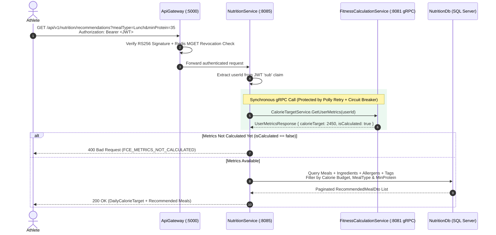
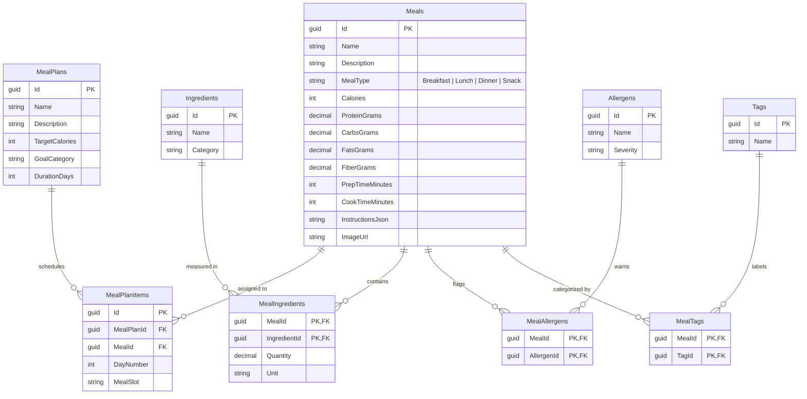

<div align="center">


# NutritionService — Macro-Aligned Meal Plans & gRPC Recommendation Engine

**Intelligent Dietary Prescription & Meal Recommendation Microservice Built with .NET 9, Vertical Slice Architecture, CQRS + MediatR, EF Core 9, RS256 JWT Authentication, and Polly-Resilient gRPC Integration**

</div>

---

## 1. Overview & Core Responsibilities

`NutritionService` (Port `:8085`) manages the nutritional domain of NextRep, transforming an athlete's metabolic calorie and macronutrient targets into actionable daily meals and structured meal plans:

- **Personalized gRPC-Driven Meal Recommendations:** Connects synchronously to `FitnessCalculationService` via gRPC (`CalorieTargetService.GetUserMetrics`) to retrieve the athlete's real-time calculated daily calorie target, then filters and ranks meals by meal type (`Breakfast`, `Lunch`, `Dinner`, `Snack`), caloric ceiling, and minimum protein thresholds.
- **Rich Relational Nutritional Graph (`NutritionDb`):** Models meals with complete macro breakdowns (`Calories`, `ProteinGrams`, `CarbsGrams`, `FatsGrams`, `FiberGrams`), preparation/cooking times, step-by-step instructions, ingredient quantities (`MealIngredients`), allergen warnings (`MealAllergens`), and dietary tags (`High-Protein`, `Keto`, `Vegan`, `Low-Carb`, etc.).
- **Resilient Inter-Service Communication:** Wraps outbound gRPC calls in **Polly resilience policies** ([`GrpcPolicies.cs`](./Common/GrpcPolicies.cs)) featuring exponential backoff retries and circuit-breaker protection.
- **Local RS256 Token Validation:** Verifies JWT Bearer tokens locally in `0 ms` using `keys/auth-service-public.pem`.

---

## 2. Architecture & gRPC Recommendation Flow



---

## 3. Database Schema (`NutritionDb`)

`NutritionDb` is automatically migrated and seeded with curated athletic meals, ingredients, allergens, tags, and structured meal plans on startup via [`NutritionDbSeeder.cs`](./Common/Database/NutritionDbSeeder.cs).



---

## 4. Complete REST API Reference

Base Route: `/api/v1/nutrition` (All endpoints require `Authorization: Bearer <token>`)

| Method | Endpoint | Query / Route Parameters | Description |
| :---: | :--- | :--- | :--- |
| `GET` | `/meals/{id:guid}` | `id` (Route `Guid`) | Returns full nutritional facts, macro breakdown, ingredients, allergens, tags, and preparation steps for a specific meal. |
| `GET` | `/meal-plans` | `pageNumber=1`, `pageSize=10` | Returns a paginated catalog of structured multi-day meal plans with their scheduled meals. |
| `GET` | `/meal-plans/by-calories` | `calories` (Required `int`) | Finds meal plans matching the specified daily calorie target tolerance window. |
| `GET` | `/recommendations` | `mealType?`, `maxCalories?`, `minProtein?`, `page=1`, `pageSize=10` | Fetches the authenticated user's calorie target from `FitnessCalculationService` via gRPC and returns personalized meal recommendations. |
| `GET` | `/recommendations/{userId}` | `userId` (Route), `mealType?`, `maxCalories?`, `minProtein?`, `page=1`, `pageSize=10` | Retrieves macro-aligned meal recommendations for a specific `userId`. |

---

## 5. Feature Slice Directory Structure

```text
NutritionService/
├── Common/
│   ├── Behaviors/ValidationBehavior.cs      # MediatR FluentValidation pipeline
│   ├── Database/                            # ApplicationDbContext, UnitOfWork, GenericRepository, Seeder
│   ├── Protos/calorie_target.proto          # gRPC client contract to FitnessCalculationService
│   └── GrpcPolicies.cs                      # Polly retry & circuit-breaker policies
├── Controllers/
│   └── MealPlansController.cs               # REST API endpoints (/api/v1/nutrition/*)
├── Features/
│   ├── BrowseMealPlans/                     # Paginated meal plan browsing & calorie filtering slices
│   ├── GetMealDetail/                       # Full meal macro, ingredient & allergen projection slice
│   └── GetMealRecommendations/              # gRPC-backed personalized recommendation slice
└── Models/                                  # Domain entities (Meal, MealPlan, Ingredient, Allergen, Tag)
```
