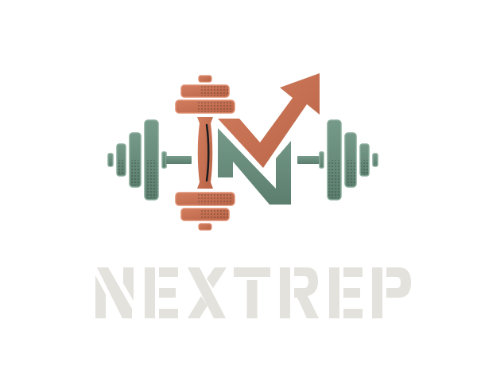
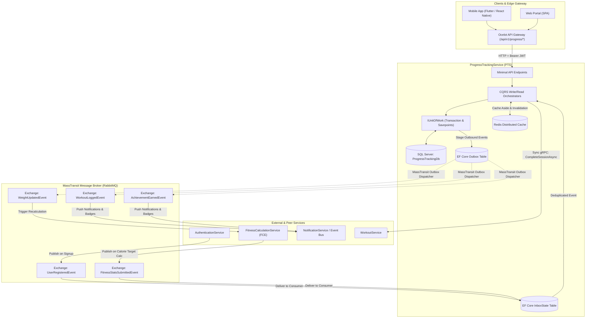
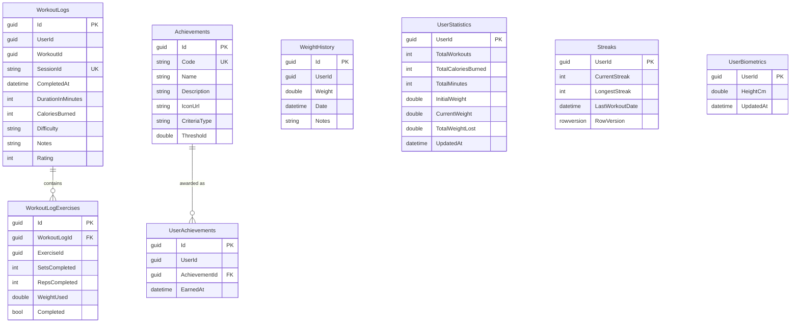
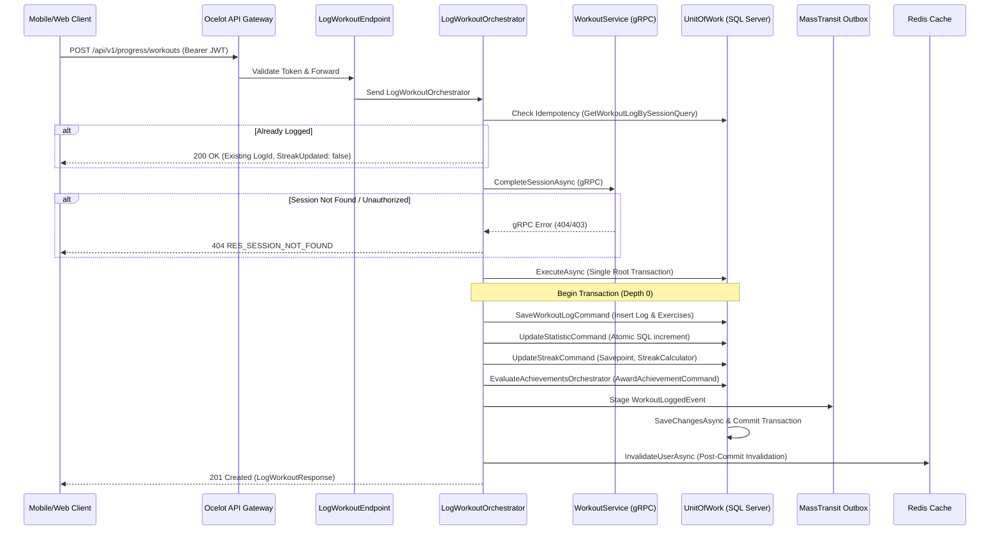
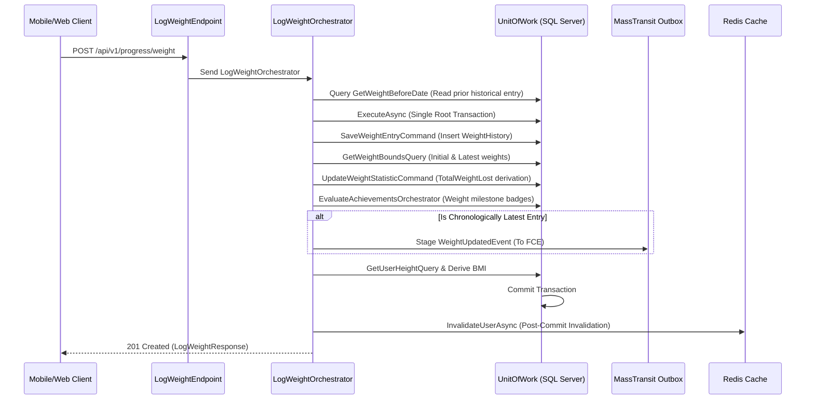
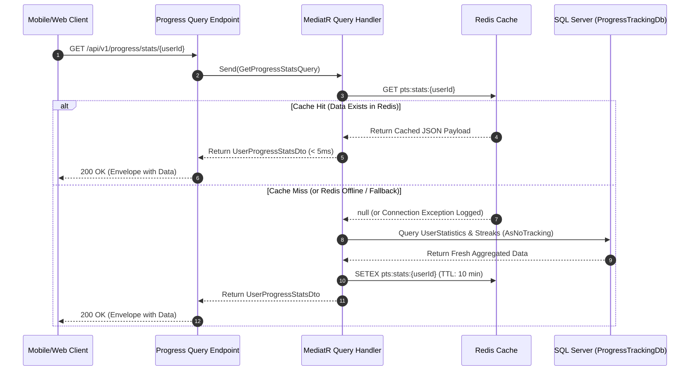
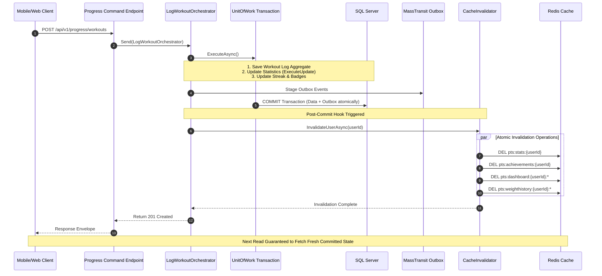

<div align="center">



</div>

# Progress Tracking Service (PTS) — Architecture & Business Guide

> **Microservice:** `ProgressTrackingService`  
> **Framework:** .NET 9.0 (ASP.NET Core Minimal APIs + MediatR 14)  
> **Architecture Pattern:** CQRS with Orchestrators & Unit of Work (Transaction Savepoints) & Vertical Slicing  
> **Data & Messaging:** SQL Server 2022 (EF Core 9) + MassTransit 8.5 (RabbitMQ & Transactional Outbox) + Redis 7 (StackExchange)  
> **Inter-Service Communication:** gRPC Client (WorkoutService Session Completion)  
> **Security:** RS256 Asymmetric JWT Authentication with Custom Claims & Resource Ownership Validation (`UserAccessGuard`)  

---

## 1. Business Domain Overview

### 1.1 Purpose in NextRep Ecosystem
The **Progress Tracking Service (PTS)** is the central motivational, gamification, and historical analytics engine of the NextRep microservice platform. It captures daily workout completions, tracks body weight milestones, calculates consecutive training streaks, evaluates and awards milestone achievement badges, and projects comprehensive period-over-period analytics dashboards for athletes and coaches.

Downstream and peer microservices depend on PTS:
* **Authentication Service:** Publishes `UserRegisteredEvent` when a new athlete registers. PTS idempotently initializes baseline progress records (0 workouts, 0 streak) so new users never experience empty state exceptions.
* **Workout Service:** Synchronously called via gRPC (`CompleteSessionAsync`) when an athlete logs a workout session to verify session existence, ownership, and transition the session to completed status.
* **Fitness Calculation Service (FCE):** Consumes `WeightUpdatedEvent` published by PTS when a new chronological weight entry is logged to trigger automatic metabolic recalibration (BMR, TDEE, Calorie Target, Plan reassignment). PTS also consumes `FitnessStatsSubmittedEvent` from FCE to project user height for accurate BMI calculations.
* **API Gateway (Ocelot):** Downstream routing exposes progress endpoints with rate limiting, circuit breaker policies, and JWT token propagation.

---

### 1.3 Cross-Service External Calls & Messaging Topology Graph

The following diagram details all synchronous gRPC calls, asynchronous RabbitMQ message contracts, transactional outbox/inbox mechanisms, and gateway entry points connecting `ProgressTrackingService` to the wider NextRep ecosystem:



---

### 1.2 Mathematical & Pure Domain Engine

All core business calculations are implemented as pure, deterministic domain classes in `ProgressTrackingService.Common.Domain`:

#### 1. Streak Calculation (`StreakCalculator`)
Calculates habit streaks using UTC midnight boundaries:
* **First Workout Ever:** `CurrentStreak = 1`, `LongestStreak = 1`, `StreakUpdated = true`.
* **Consecutive Day Workout:** If workout completed on the day immediately following `LastWorkoutDate`, `CurrentStreak += 1`, `LongestStreak = Math.Max(CurrentStreak, LongestStreak)`, `StreakUpdated = true`.
* **Same-Day Workout:** If another workout is logged on the same calendar day (UTC), streak is preserved without double-counting (`StreakUpdated = false`).
* **Broken Streak (Gap $\ge 2$ days):** If $\ge 2$ days elapsed, streak resets to 1, while preserving `LongestStreak`.
* **Back-Dated Workout:** Workouts completed before `LastWorkoutDate` are recorded historically without altering forward streak counts.
* **Pure Read-Time Decay (`EffectiveCurrent`):** If query runs on day $D$ and `LastWorkoutDate < D - 1`, the query reports `CurrentStreak = 0` at read time without executing a database write.

#### 2. Body Mass Index (`BmiCalculator`)
Calculates standard BMI derived from metric height and weight:
$$\text{BMI} = \frac{\text{Weight}_{\text{kg}}}{(\text{Height}_{\text{m}})^2} = \frac{\text{Weight}_{\text{kg}}}{(\text{Height}_{\text{cm}} / 100)^2}$$
* Output rounded to 1 decimal place.
* Returns `null` safely if height has not yet been submitted.

#### 3. Period Resolution (`PeriodResolver`)
Resolves date ranges for the analytics dashboard:
* **`week`:** Last 7 days $[T - 6\text{ days}, T]$; previous range $[T - 13\text{ days}, T - 7\text{ days}]$.
* **`month`:** Last 30 days $[T - 29\text{ days}, T]$; previous range $[T - 59\text{ days}, T - 30\text{ days}]$.
* **`year`:** Last 365 days $[T - 364\text{ days}, T]$; previous range $[T - 729\text{ days}, T - 365\text{ days}]$.
* **`all`:** From athlete's first recorded activity to $T$ (no previous range).
* **`custom`:** Custom `startDate` to `endDate` (max range: 2 years; validates `startDate <= endDate`).

#### 4. Milestone Achievements (`AchievementRuleEvaluator`)
Evaluates earned milestone badges against athlete progress snapshots:
* **`TotalWorkouts`:** Evaluates total completed workout sessions (e.g. 1st workout, 10th workout, 50th workout).
* **`StreakDays`:** Evaluates consecutive workout streak milestones (e.g. 7-day streak, 30-day streak).
* **`TotalCalories`:** Evaluates cumulative calories burned (e.g. 10,000 kcal club).
* **`WeightLostKg`:** Evaluates net body mass loss milestones (e.g. 1 kg, 5 kg, 10 kg lost).
* Badges are earned exactly once; previously earned badges are skipped.

---

## 2. Technical Architecture & Database Schema

### 2.1 Entity Relationship Diagram



---

## 3. Core Architectural Workflows

### 3.1 Log Workout Flow (`POST /api/v1/progress/workouts`)



### 3.2 Log Weight Flow (`POST /api/v1/progress/weight`)



---

## 4. Complete Endpoint Specification Catalog

All responses follow the unified envelope:
```json
{
  "isSuccess": true,
  "message": "Operation completed successfully.",
  "data": { ... },
  "errors": [],
  "statusCode": 200,
  "timestamp": "2026-11-04T12:00:00Z"
}
```

| Method | Endpoint Path | Summary | Produces | Error Codes |
| :--- | :--- | :--- | :--- | :--- |
| `POST` | `/api/v1/progress/workouts` | Log completed workout session, increment streaks, evaluate trophies | `201`, `400`, `401`, `404`, `503` | `RES_SESSION_NOT_FOUND`, `VAL_INVALID_DIFFICULTY`, `VAL_INVALID_RATING`, `VAL_INVALID_DATE` |
| `POST` | `/api/v1/progress/weight` | Log weight entry, derive BMI, update stats & milestones | `201`, `400`, `401`, `404` | `VAL_INVALID_WEIGHT`, `VAL_INVALID_DATE`, `RES_USER_NOT_FOUND` |
| `GET` | `/api/v1/progress/weight-history/{userId}` | Chronological paged weight history (`Date ASC`) | `200`, `400`, `401`, `403` | `AUTH_TOKEN_INVALID`, `PERM_FORBIDDEN` |
| `GET` | `/api/v1/progress/stats/{userId}` | Aggregated statistics with pure read-time streak decay | `200`, `401`, `403`, `404` | `RES_USER_NOT_FOUND`, `PERM_FORBIDDEN` |
| `GET` | `/api/v1/progress/achievements` | Unlocked achievements with optional catalog merge | `200`, `401` | `AUTH_TOKEN_INVALID` |
| `GET` | `/api/v1/progress/{userId}` | User progress profile with bounded lists | `200`, `401`, `403`, `404` | `RES_USER_NOT_FOUND`, `PERM_FORBIDDEN` |
| `GET` | `/api/v1/progress` | Period analytics dashboard with % comparisons & trends | `200`, `400`, `401` | `VAL_INVALID_PERIOD`, `VAL_INVALID_DATE` |

---

## 5. Distributed Caching Architecture (Redis)

### 5.1 Caching Strategy & Resilience
* **Cache-Aside Pattern:** Query handlers check Redis before accessing SQL Server. On a cache hit, data is returned instantly (< 5ms) without touching the database. On a cache miss, data is queried from SQL Server with `.AsNoTracking()`, serialized, and cached with a bounded TTL.
* **Fault-Tolerant Fallback:** If Redis is down, calls degrade gracefully to SQL Server without throwing exceptions or degrading user experience (`RedisCacheService` logs a warning and continues).
* **Atomic Post-Commit Invalidation:** Cache invalidation runs strictly **after** `UnitOfWork.CommitAsync()` succeeds, preventing dirty reads where the cache is cleared while the database transaction is rolled back.

---

### 5.2 Cache-Aside Read Flow Diagram



---

### 5.3 Post-Commit Cache Invalidation Write Flow Diagram



---

### 5.4 Cache Keys & TTLs Catalog

| Cache Key Pattern | TTL | Contents | Invalidation Triggers |
| :--- | :---: | :--- | :--- |
| `pts:stats:{userId}` | 10 min | Aggregated statistics DTO | Workout logged, Weight logged |
| `pts:achievements:{userId}` | 30 min | Earned trophy DTO collection | Milestone achievement earned |
| `pts:achievements:catalog` | 24 hr | Master achievement catalog | Master catalog changes |
| `pts:dashboard:{userId}:{period}` | 5 min | Period analytics dashboard response | Workout logged, Weight logged |
| `pts:weighthistory:{userId}:p{page}:s{size}` | 5 min | Paged weight history segment | Weight logged |

---

## 6. Error Codes Catalog

| Error Code | HTTP Status | Description |
| :--- | :---: | :--- |
| `RES_SESSION_NOT_FOUND` | 404 | Workout session ID does not exist in WorkoutService or is not owned by user |
| `RES_USER_NOT_FOUND` | 404 | User ID not found in system |
| `VAL_REQUIRED_FIELD` | 400 | A mandatory field was missing or default |
| `VAL_INVALID_WEIGHT` | 400 | Weight out of valid range (30.0 kg – 300.0 kg) |
| `VAL_INVALID_DATE` | 400 | Future date supplied or `startDate > endDate` |
| `VAL_INVALID_DIFFICULTY`| 400 | Difficulty string not recognized (`Beginner`, `Intermediate`, `Advanced`) |
| `VAL_INVALID_RATING` | 400 | Rating integer outside 1–5 range |
| `VAL_INVALID_PERIOD` | 400 | Dashboard period not one of `week`, `month`, `year`, `all` |
| `AUTH_TOKEN_INVALID` | 401 | Missing, expired, or invalid JWT signature |
| `PERM_FORBIDDEN` | 403 | Caller attempting to access progress data of another user without Admin role |
| `SRV_SERVICE_UNAVAILABLE`| 503 | Downstream service (WorkoutService gRPC) unavailable or timed out |

---

## 7. Manual Walkthrough Scenario

To test the entire habit loop manually:

1. **Authenticate as Athlete:**
   ```bash
   POST http://localhost:8080/api/v1/auth/login
   {
     "email": "testuser@nextrep.com",
     "password": "Password123!"
   }
   ```
   Save the returned `accessToken`.

2. **Log Completed Workout Session:**
   ```bash
   POST http://localhost:8080/api/v1/progress/workouts
   Authorization: Bearer <TOKEN>
   {
     "workoutId": "3fa85f64-5717-4562-b3fc-2c963f66afa6",
     "sessionId": "session-live-001",
     "completedAt": "2026-11-04T12:00:00Z",
     "duration": 45,
     "caloriesBurned": 350,
     "difficulty": "Intermediate",
     "rating": 5,
     "exercisesCompleted": []
   }
   ```
   *Expected Response:* `201 Created` with `currentStreak: 1`, `streakUpdated: true`, and first workout badge if earned.

3. **Log Weight Check-In:**
   ```bash
   POST http://localhost:8080/api/v1/progress/weight
   Authorization: Bearer <TOKEN>
   {
     "weight": 79.5,
     "date": "2026-11-04T12:05:00Z",
     "notes": "Post-workout weigh-in"
   }
   ```
   *Expected Response:* `201 Created` with derived `bmi`, `differenceFromPrevious`, and `totalWeightLost`.

4. **Retrieve Progress Dashboard:**
   ```bash
   GET http://localhost:8080/api/v1/progress?period=week
   Authorization: Bearer <TOKEN>
   ```
   *First call:* Computes analytics from SQL Server, saves to Redis.  
   *Second call:* Returns in < 5ms directly from Redis cache (`pts:dashboard:{userId}:week`).

---

## 8. Automated Testing & CI/CD Quality Gate

### 8.1 Running Test Suites Locally
Execute tests across the entire solution:
```bash
# Run all solution tests
dotnet test FitnessApp.slnx -c Release

# Run ProgressTrackingService tests with coverage collection
dotnet test ProgressTrackingService/ProgressTrackingService.csproj -c Release --collect:"XPlat Code Coverage"
```

### 8.2 CI/CD Pipeline (`.github/workflows/production.yml`)
The GitHub Actions workflow enforces a strict quality gate:
1. **`test` Stage:** Runs `dotnet test FitnessApp.slnx -c Release --logger trx --collect:"XPlat Code Coverage"`.
2. **`build-and-push` Stage:** Depends on `[generate-tag, test]`. If any unit test fails, the workflow immediately halts and **no Docker images are built or pushed to Docker Hub**.
3. **Current Test Status:** 172 passed, 0 failed (119 in `ProgressTrackingService`, 53 in `FitnessCalculationService`).
