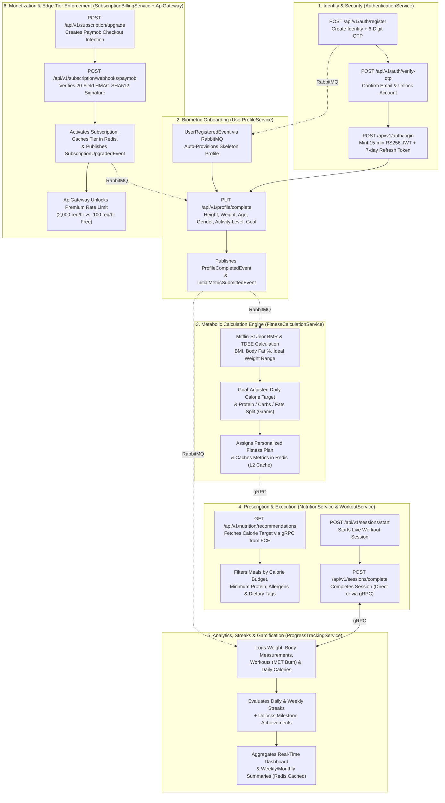
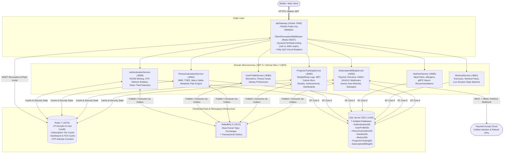
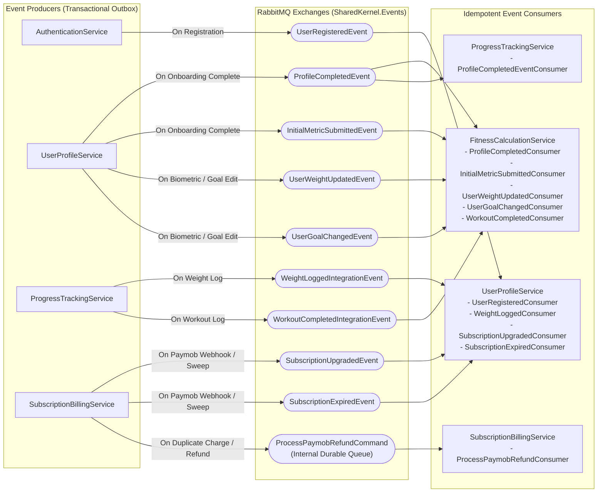
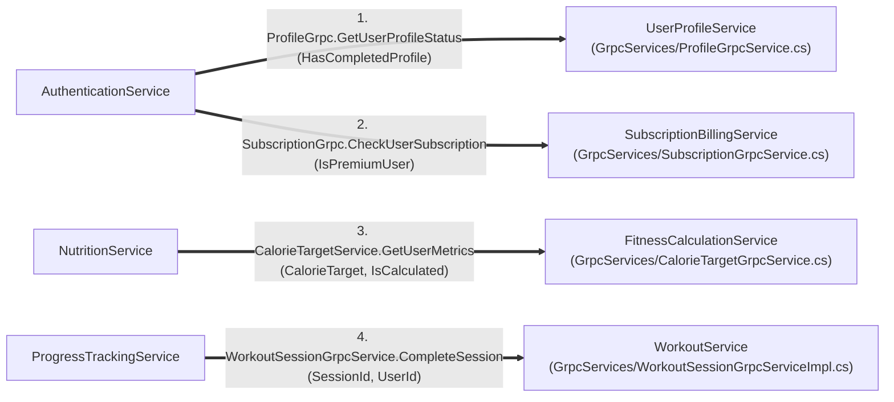
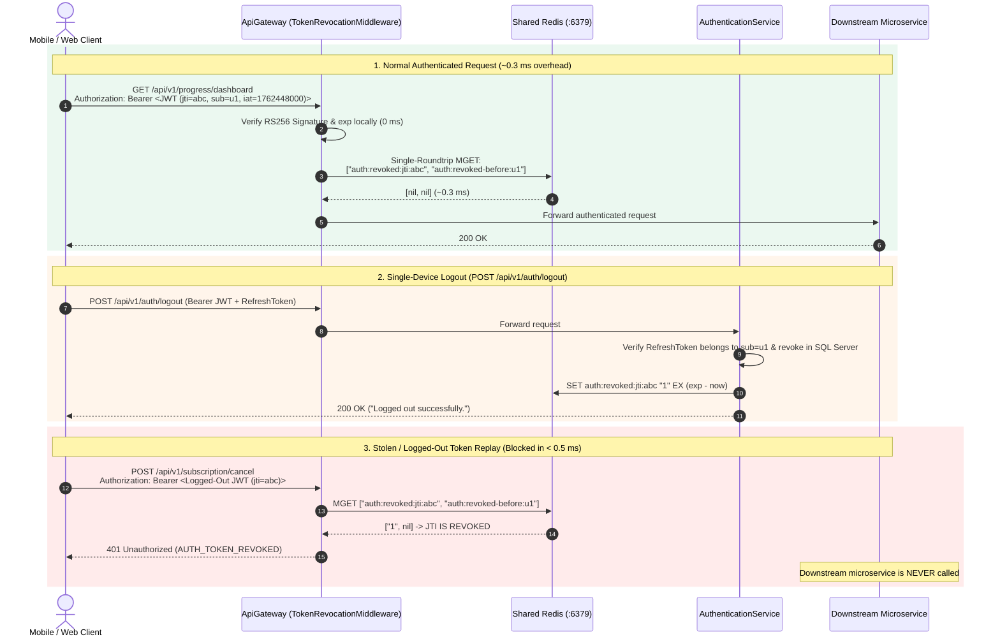
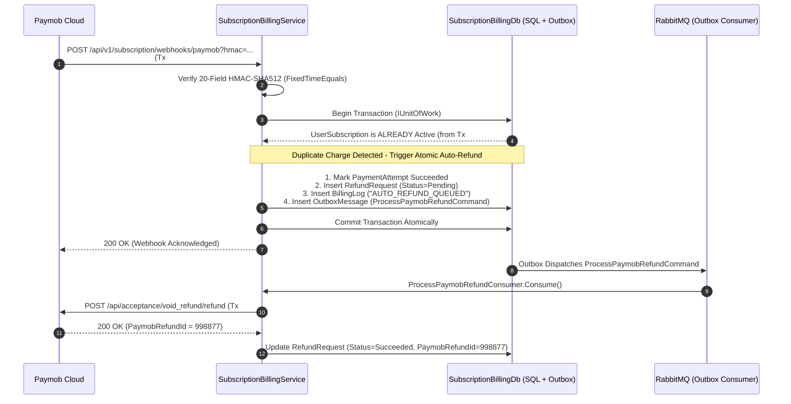

<div align="center">


# NextRep — Cloud-Native Microservices Fitness & Billing Platform

**A Production-Grade Distributed System Built with .NET 9, Vertical Slice Architecture, CQRS, MassTransit Transactional Outbox, gRPC, Redis, Ocelot API Gateway, RS256 JWT + Sub-Millisecond Hybrid Token Revocation, and Native Paymob Payment Processing**

[](https://dotnet.microsoft.com/)
[](./FitnessApp.slnx)
[](./docker-compose.yml)
[-244C5A?style=for-the-badge&logo=google&logoColor=white)](./docker-compose.yml)
[](./ApiGateway/Middleware/TokenRevocationMiddleware.cs)
[-CC2927?style=for-the-badge&logo=microsoftsqlserver&logoColor=white)](./docker-compose.yml)
[](./SubscriptionBillingService/README.md)
[-2EA44F?style=for-the-badge&logo=githubactions&logoColor=white)](./.github/workflows/production.yml)

</div>

---

## Table of Contents

1. [Executive Overview & Engineering Highlights](#1-executive-overview--engineering-highlights)
2. [End-to-End Business Flow (The 6-Stage Athlete Lifecycle)](#2-end-to-end-business-flow-the-6-stage-athlete-lifecycle)
3. [High-Level System Architecture](#3-high-level-system-architecture)
4. [Inter-Service Communication Graphs (RabbitMQ & gRPC)](#4-inter-service-communication-graphs-rabbitmq--grpc)
   - [4.1 Asynchronous Event-Driven Topology (RabbitMQ + MassTransit Outbox)](#41-asynchronous-event-driven-topology-rabbitmq--masstransit-outbox)
   - [4.2 Synchronous High-Performance RPC Topology (gRPC over HTTP/2)](#42-synchronous-high-performance-rpc-topology-grpc-over-http2)
5. [Hard Distributed Systems Problems We Solved](#5-hard-distributed-systems-problems-we-solved)
   - [5.1 RS256 Asymmetric JWTs & The `< 0.3 ms` Hybrid Redis Token Revocation Pipeline](#51-rs256-asymmetric-jwts--the--03-ms-hybrid-redis-token-revocation-pipeline)
   - [5.2 RFC 6819 Refresh Token Reuse / Theft Detection & Multi-Device Session Cutoffs](#52-rfc-6819-refresh-token-reuse--theft-detection--multi-device-session-cutoffs)
   - [5.3 Native Paymob Integration, Constant-Time HMAC-SHA512 & Atomic Auto-Refunds on Race Conditions](#53-native-paymob-integration-constant-time-hmac-sha512--atomic-auto-refunds-on-race-conditions)
   - [5.4 Eliminating Dual-Write Bugs via the MassTransit EF Core Transactional Outbox](#54-eliminating-dual-write-bugs-via-the-masstransit-ef-core-transactional-outbox)
   - [5.5 Dynamic Subscription-Tier Rate Limiting at the Edge (`ApiGateway`)](#55-dynamic-subscription-tier-rate-limiting-at-the-edge-apigateway)
   - [5.6 Decoupling External gRPC Network I/O from SQL Server Transactions](#56-decoupling-external-grpc-network-io-from-sql-server-transactions)
6. [Database-per-Service SQL Server Architecture (Full ER Diagrams)](#6-database-per-service-sql-server-architecture-full-er-diagrams)
7. [Microservice Catalog & Service-Specific Documentation](#7-microservice-catalog--service-specific-documentation)
8. [Getting Started (Docker Compose & Local Test Suite)](#8-getting-started-docker-compose--local-test-suite)

---

## 1. Executive Overview & Engineering Highlights

**NextRep** is an enterprise-grade, cloud-native fitness, nutrition, biometric analytics, and subscription billing platform engineered around **8 independently deployable services** (1 Ocelot API Gateway + 7 Domain Microservices).

Rather than building a CRUD monolith, this system was architected to solve real production challenges encountered in high-throughput consumer health and fintech applications:

| Engineering Pillar | How It Is Engineered in NextRep |
| :--- | :--- |
| **Vertical Slice Architecture + CQRS** | Every microservice organizes code by **business feature slice** (`Features/<Domain>/Commands`, `Queries`, `Orchestrators`, `Consumers`, `Validators`) using **MediatR** and **FluentValidation** pipeline behaviors — zero bloated service layers. |
| **Asymmetric RS256 Security + Instant Revocation** | `AuthenticationService` signs tokens with a 2048-bit RSA Private Key (`private.pem`); `ApiGateway` and all 6 downstream services validate signatures locally in `0 ms` using `auth-service-public.pem`, paired with a **single-roundtrip Redis `MGET` denylist (`~0.3 ms`)** that invalidates logged-out or compromised tokens immediately. |
| **RFC 6819 Refresh Token Theft Detection** | Replay of an already-rotated Refresh Token triggers an automatic security lockdown: all active Refresh Tokens in SQL Server are revoked and a user-wide Redis timestamp cutoff (`auth:revoked-before:{userId}`) invalidates every active JWT across all devices. |
| **Transactional Outbox Pattern** | Domain state changes and integration events (`UserRegisteredEvent`, `SubscriptionUpgradedEvent`, `WorkoutCompletedIntegrationEvent`, etc.) are committed **atomically in the same SQL Server transaction** via MassTransit EF Core Outbox (`InboxState`, `OutboxMessage`, `OutboxState`), guaranteeing at-least-once delivery with zero dual-write data loss. |
| **Fintech-Grade Payment & Auto-Refund Engine** | Native **Paymob Unified Intention API** integration with 20-field lexicographical **HMAC-SHA512** webhook verification (`CryptographicOperations.FixedTimeEquals`) and **Atomic Outbox-Driven Auto-Refunds** when concurrent webhook race conditions double-charge an already-active subscriber. |
| **Polyglot Inter-Service Transport** | **gRPC (HTTP/2 + Protobuf)** with Polly circuit-breakers and exponential retry policies for low-latency synchronous reads/commands; **RabbitMQ + MassTransit** for decoupled event-driven choreography. |
| **Database-per-Service Isolation** | **7 isolated SQL Server databases** (`AuthenticationDb`, `UserProfileDb`, `FitnessCalculationDb`, `NutritionDb`, `WorkoutDb`, `ProgressTrackingDb`, `SubscriptionBillingDb`) — zero cross-database foreign keys or shared tables. |
| **225 Automated Unit & Integration Tests** | Comprehensive test suites across services running on **xUnit**, **NSubstitute**, and **SQLite in-memory relational engines** with **XPlat Code Coverage** enforced in GitHub Actions CI/CD before Docker Hub image publishing. |

---

## 2. End-to-End Business Flow (The 6-Stage Athlete Lifecycle)

The diagram below illustrates how an athlete's journey flows across all 7 domain microservices from registration to daily training and subscription billing:



---

## 3. High-Level System Architecture

All external client traffic enters exclusively through **`ApiGateway` (Port `5000`)**, which enforces **CORS**, **Correlation ID propagation (`X-Correlation-ID`)**, **RS256 Signature Verification**, **Sub-Millisecond Redis Token Revocation (`TokenRevocationMiddleware`)**, and **Dynamic Subscription-Tier Rate Limiting (`DynamicTierRateLimitingMiddleware`)** before routing to downstream microservices.



---

## 4. Inter-Service Communication Graphs (RabbitMQ & gRPC)

NextRep separates **asynchronous state propagation** (event-driven choreography via RabbitMQ) from **synchronous real-time queries/commands** (gRPC over HTTP/2).

### 4.1 Asynchronous Event-Driven Topology (RabbitMQ + MassTransit Outbox)

Every event below is persisted inside the producer's SQL Server `OutboxMessage` table within the same database transaction as the domain entity mutation, then reliably dispatched by the MassTransit Outbox background delivery service.



#### Complete Integration Event Catalog

| Event / Message Contract | Producer | Consumer(s) | Business Purpose |
| :--- | :--- | :--- | :--- |
| `UserRegisteredEvent` | `AuthenticationService` | `UserProfileService` | Automatically provisions an initial `UserProfile` row as soon as an account is registered. |
| `ProfileCompletedEvent` | `UserProfileService` | `FitnessCalculationService`, `ProgressTrackingService` | Triggers initial BMR/TDEE/Macro calculation and initializes the athlete's baseline weight & streak tracking records. |
| `InitialMetricSubmittedEvent` | `UserProfileService` | `FitnessCalculationService` | Seeds initial body metrics for metabolic plan assignment. |
| `UserWeightUpdatedEvent` | `UserProfileService` | `FitnessCalculationService` | Recalculates BMR, TDEE, BMI, and macro targets whenever the user's weight changes significantly (`>= 0.5 kg`). |
| `UserGoalChangedEvent` | `UserProfileService` | `FitnessCalculationService` | Re-adjusts daily caloric surplus/deficit and macro ratios when the athlete switches goals (e.g., *Weight Loss* $\rightarrow$ *Muscle Gain*). |
| `WeightLoggedIntegrationEvent` | `ProgressTrackingService` | `UserProfileService` | Keeps the current weight on `UserProfile` synchronized when a user logs a weigh-in in `ProgressTrackingService`. |
| `WorkoutCompletedIntegrationEvent` | `ProgressTrackingService` | `FitnessCalculationService` | Feeds completed workout expenditure (`CaloriesBurned`, `DurationMinutes`) into the metabolic audit history. |
| `SubscriptionUpgradedEvent` | `SubscriptionBillingService` | `UserProfileService` | Updates the user's profile subscription badge and tier upon verified Paymob payment. |
| `SubscriptionExpiredEvent` | `SubscriptionBillingService` | `UserProfileService` | Downgrades the user's profile status to `Free` when `SubscriptionExpirationSweeper` detects an expired billing cycle. |
| `ProcessPaymobRefundCommand` | `SubscriptionBillingService` | `SubscriptionBillingService` | Durable internal outbox command that executes Paymob HTTP refunds with exponential retry (`5s, 15s, 30s, 60s, 120s`) and fallback sweepers. |

---

### 4.2 Synchronous High-Performance RPC Topology (gRPC over HTTP/2)

When a microservice requires immediate data from another bounded context during a request lifecycle, it uses **gRPC (Protocol Buffers over HTTP/2)** wrapped in **Polly resilience pipelines** (exponential backoff + circuit breakers):



| # | gRPC Client (Caller) | gRPC Server (Callee) | Proto Contract | Purpose & Resilience Strategy |
| :- | :--- | :--- | :--- | :--- |
| **1** | `AuthenticationService` | `UserProfileService` | `ProfileGrpc.GetUserProfileStatus` | Enriches the login response with `hasCompletedProfile` so the mobile app knows whether to route to Onboarding or Home. Runs **outside** the SQL transaction; falls back to `false` on timeout. |
| **2** | `AuthenticationService` | `SubscriptionBillingService` | `SubscriptionGrpc.CheckUserSubscription` | Enriches the login response with `isPremium`. Runs in parallel (`Task.WhenAll`) with #1 outside the SQL lock. |
| **3** | `NutritionService` | `FitnessCalculationService` | `CalorieTargetService.GetUserMetrics` | Retrieves the user's calculated daily calorie target to recommend macro-aligned meals. Protected by Polly retry (`3 attempts`) + circuit breaker (`GrpcPolicies.cs`). |
| **4** | `ProgressTrackingService` | `WorkoutService` | `WorkoutSessionGrpcService.CompleteSession` | Synchronously transitions an active `WorkoutSession` to `Completed` before recording burned calories (`MET * 3.5 * WeightKg / 200 * Duration`) and incrementing workout streaks. |

---

## 5. Hard Distributed Systems Problems We Solved

### 5.1 RS256 Asymmetric JWTs & The `< 0.3 ms` Hybrid Redis Token Revocation Pipeline

#### The Architectural Problem
In a distributed microservices platform, verifying tokens by calling `AuthenticationService` on every HTTP request creates a **Single Point of Failure (SPOF)** and adds `10–25 ms` of network/SQL latency to every API call.
To avoid this, NextRep uses **RS256 (RSA Signature with SHA-256)**:
- Only `AuthenticationService` holds the **2048-bit RSA Private Key** (`auth-service-private.pem`) to mint tokens.
- `ApiGateway` and all downstream microservices hold the **read-only RSA Public Key** (`auth-service-public.pem`) to verify token signatures **100% locally in CPU memory (`0 ms`)**.

**However, pure stateless JWTs have a critical flaw:** if a user logs out, changes their password after a breach, or has their token stolen via XSS/network sniffing, a traditional stateless JWT **remains completely valid across every microservice until its `exp` timestamp expires.**

#### How We Solved It (Hybrid #1 + #2 + #3 Pipeline)
We engineered a **3-layer hybrid revocation architecture** shared between `AuthenticationService` and `ApiGateway` via Redis:

1. **Short-Lived Access Token TTL (`15 Minutes`):** Bounds the maximum lifetime of any Redis denylist key to at most 900 seconds, keeping Redis memory consumption under **`1 MB` even at 10,000 concurrent logouts**.
2. **Per-Token `jti` Denylist (`auth:revoked:jti:{jti}`):** When a user calls `POST /api/v1/auth/logout`, [`LogoutOrchestratorHandler`](./AuthenticationService/Features/Auth/Orchestrators/Logout/LogoutOrchestratorHandler.cs) extracts the token's unique `jti` (`JwtRegisteredClaimNames.Jti`) and remaining lifetime (`exp - UtcNow`), writing `SET auth:revoked:jti:{jti} "1" EX <remainingSeconds>`. This revokes that specific device immediately without kicking the user off their other devices.
3. **Per-User Timestamp Cutoff (`auth:revoked-before:{userId}`):** When a user calls `POST /api/v1/auth/logout-all`, changes their password, resets their password, or triggers refresh-token theft detection, [`RedisTokenRevocationStore`](./AuthenticationService/Services/RedisTokenRevocationStore.cs) writes `SET auth:revoked-before:{userId} "<nowUnixSeconds>" EX 900`. Any JWT for that user whose `iat` (*Issued At*) claim is `<= cutoffUnix` is rejected across the entire platform in $O(1)$ time.
4. **Single-Roundtrip Atomic `MGET` at `ApiGateway`:** On every authenticated request, [`TokenRevocationMiddleware`](./ApiGateway/Middleware/TokenRevocationMiddleware.cs) batches both checks into a **single Redis `MGET` network packet (`~0.3 ms`)**:



---

### 5.2 RFC 6819 Refresh Token Reuse / Theft Detection & Multi-Device Session Cutoffs

#### The Problem
If an attacker steals a user's 7-day Refresh Token and rotates it first, the old Refresh Token is marked `RevokedAt != null` in SQL Server. When the legitimate user's phone later attempts to refresh using that original token, naive implementations simply return `401 Unauthorized` to the victim while **leaving the attacker's newly rotated Refresh Token active for 7 days.**

#### Our Solution
In [`RefreshTokenOrchestratorHandler.cs`](./AuthenticationService/Features/Auth/Orchestrators/RefreshToken/RefreshTokenOrchestratorHandler.cs), if an already-revoked Refresh Token (`RevokedAt != null`) is ever presented:
1. The server immediately recognizes a **Refresh Token Replay / Theft Event (RFC 6819 Section 5.2.2.3)**.
2. It executes [`RevokeAllRefreshTokensCommand`](./AuthenticationService/Features/Auth/Commands/RevokeAllRefreshTokens/RevokeAllRefreshTokensCommandHandler.cs) to invalidate **every active Refresh Token** for that user in SQL Server.
3. It writes `auth:revoked-before:{userId} = UtcNow` to Redis, immediately invalidating the attacker's active 15-minute JWT at `ApiGateway`.
4. It returns `401 Unauthorized` with error code `AUTH_TOKEN_THEFT_DETECTED`, forcing a clean re-authentication.

---

### 5.3 Native Paymob Integration, Constant-Time HMAC-SHA512 & Atomic Auto-Refunds on Race Conditions

#### The Problem
In payment systems, a user might accidentally pay twice (e.g., opening two checkout tabs or retrying a slow mobile connection), or a payment gateway might deliver two concurrent `TRANSACTION` webhooks for separate payment intentions. If the user's subscription was already activated by Transaction #1, simply ignoring Transaction #2 leaves the customer **double-charged in real money** with no extra subscription value.

#### Our Solution
In [`ProcessPaymobWebhookOrchestrator.cs`](./SubscriptionBillingService/Features/Subscriptions/Orchestrators/ProcessPaymobWebhookOrchestrator.cs):
1. **Cryptographic Webhook Authenticity:** [`PaymobHmacValidator`](./SubscriptionBillingService/Infrastructure/Paymob/PaymobHmacValidator.cs) extracts the 20 required Paymob transaction fields in strict lexicographical order, computes the `HMAC-SHA512` digest, and compares bytes using **`CryptographicOperations.FixedTimeEquals`** to prevent timing side-channel attacks.
2. **Idempotency vs. Duplicate-Charge Detection:**
   - If the *same* `PaymobTransactionId` arrives twice (webhook retry), it returns `200 OK` idempotently.
   - If a *different* successful `PaymobTransactionId` arrives for a user whose subscription is **already `Active` with `EndDate > UtcNow`**, the orchestrator detects a **Duplicate Charge Race Condition**:
     - Inside the **same `IUnitOfWork` SQL transaction**, it logs the duplicate `PaymentAttempt`, creates a `RefundRequest` (`Reason = DuplicateActiveSubscriptionCharge`, `AmountCents`), writes an audit `BillingLog`, and publishes `ProcessPaymobRefundCommand` to the MassTransit Outbox.
     - [`ProcessPaymobRefundConsumer`](./SubscriptionBillingService/Features/Subscriptions/Consumers/ProcessPaymobRefundConsumer.cs) + [`PendingRefundSweeper`](./SubscriptionBillingService/Features/Subscriptions/Sweepers/PendingRefundSweeper.cs) automatically refund the user's card via Paymob's `/api/acceptance/void_refund/refund` endpoint.



---

### 5.4 Eliminating Dual-Write Bugs via the MassTransit EF Core Transactional Outbox

A classic microservices anti-pattern is calling `await _dbContext.SaveChangesAsync()` followed by `await _publishEndpoint.Publish(event)`. If the RabbitMQ broker is momentarily unreachable or the container crashes between those two lines, the database is updated but downstream services never receive the event (**zombie state**).

In NextRep, every event-producing service (`AuthenticationService`, `UserProfileService`, `FitnessCalculationService`, `ProgressTrackingService`, `SubscriptionBillingService`) configures the **MassTransit Entity Framework Core Transactional Outbox**:
- `modelBuilder.AddInboxStateEntity()`, `modelBuilder.AddOutboxMessageEntity()`, `modelBuilder.AddOutboxStateEntity()`
- `o.UseSqlServer(); o.UseBusOutbox();`
- All multi-step writes + event publishes execute inside `await _unitOfWork.ExecuteAsync(...)`, committing domain rows and `OutboxMessage` rows in a **single atomic SQL transaction**.

---

### 5.5 Dynamic Subscription-Tier Rate Limiting at the Edge (`ApiGateway`)

Rather than applying a static rate limit to all users, [`DynamicTierRateLimitingMiddleware`](./ApiGateway/Middleware/DynamicTierRateLimitingMiddleware.cs) in `ApiGateway` inspects the user's live subscription tier in Redis (`tier:{userId}`) and enforces hourly sliding-window quotas (`rate:user:{userId}:{yyyyMMddHH}`):
- **Free Tier:** `100 requests / hour`
- **Premium Tier:** `2,000 requests / hour` (unlocked immediately when `SubscriptionBillingService` caches `tier:{userId} = "Premium"` upon payment)
- Every response includes `X-RateLimit-Limit`, `X-RateLimit-Remaining`, and `X-RateLimit-Tier` headers.

---

### 5.6 Decoupling External gRPC Network I/O from SQL Server Transactions

During our security and performance audit of [`LoginOrchestratorHandler.cs`](./AuthenticationService/Features/Auth/Orchestrators/Login/LoginOrchestratorHandler.cs), we identified that calling `UserProfileService` and `SubscriptionBillingService` via gRPC *inside* `_unitOfWork.ExecuteAsync` held SQL Server row locks open on `Users`, `LoginAttempts`, and `RefreshTokens` for the duration of external network I/O.
We refactored `LoginOrchestratorHandler` so the SQL transaction commits and releases its connection back to the pool **first**, and then executes both read-only gRPC enrichment calls concurrently via `Task.WhenAll` outside the transaction boundary.

---

## 6. Database-per-Service SQL Server Architecture (Full ER Diagrams)

NextRep enforces strict **Database-per-Service** encapsulation on SQL Server 2022. Cross-service relationships are linked logically by `UserId (Guid)` and synchronized via integration events or gRPC.

```mermaid
erDiagram
    %% 1. AuthenticationDb
    AUTH_Users ||--o{ AUTH_RefreshTokens : "has sessions"
    AUTH_Users {
        string Id PK "GUID"
        string Email UK
        string PasswordHash
        bool EmailConfirmed
        bool IsLockedOut
        datetime LockedUntil
    }
    AUTH_RefreshTokens {
        int Id PK
        string UserId FK
        string Token
        datetime ExpiresAt
        datetime CreatedAt
        datetime RevokedAt "Nullable (RFC 6819 Theft Check)"
    }
    AUTH_OtpCodes {
        int Id PK
        string Email
        string Code "6-Digit OTP"
        bool IsUsed
        datetime ExpiresAt
    }
    AUTH_LoginAttempts {
        int Id PK
        string Email
        string IpAddress "X-Forwarded-For"
        bool IsSuccess
        datetime AttemptedAt
    }

    %% 2. UserProfileDb
    PROFILE_UserProfiles ||--o{ PROFILE_FitnessGoals : "targets"
    PROFILE_UserProfiles ||--o{ PROFILE_BodyMetrics : "tracks"
    PROFILE_UserProfiles ||--o| PROFILE_UserPreferences : "configures"
    PROFILE_UserProfiles {
        guid Id PK
        guid UserId UK
        int Age
        string Gender
        decimal HeightCm
        decimal CurrentWeightKg
        string ActivityLevel
        string SubscriptionTier "Free | Premium"
        bool IsCompleted
    }
    PROFILE_FitnessGoals {
        guid Id PK
        guid UserProfileId FK
        string GoalType "WeightLoss | MuscleGain | Maintenance"
        decimal TargetWeightKg
    }
    PROFILE_BodyMetrics {
        guid Id PK
        guid UserProfileId FK
        decimal WeightKg
        decimal BodyFatPercentage
        datetime RecordedAt
    }
    PROFILE_UserPreferences {
        guid Id PK
        guid UserProfileId FK
        string DietaryRestrictions
        string PreferredWorkoutDays
    }

    %% 3. FitnessCalculationDb
    FCE_CalculatedMetrics ||--o{ FCE_AssignedFitnessPlans : "generates"
    FCE_CalculatedMetrics {
        guid Id PK
        guid UserId
        decimal Bmr "Mifflin-St Jeor"
        decimal Tdee
        int DailyCalorieTarget
        decimal ProteinGrams
        decimal CarbsGrams
        decimal FatsGrams
        decimal Bmi
        string BmiCategory
        datetime CalculatedAt
    }
    FCE_AssignedFitnessPlans {
        guid Id PK
        guid UserId
        string PlanCategory
        int RecommendedWorkoutsPerWeek
        int TargetCalories
        bool IsActive
    }
    FCE_RecalculationAuditLogs {
        guid Id PK
        guid UserId
        string TriggerSource
        datetime ProcessedAt
    }

    %% 4. SubscriptionBillingDb
    SUB_UserSubscriptions ||--o{ SUB_BillingLogs : "audits"
    SUB_PaymentAttempts ||--o| SUB_RefundRequests : "auto-refunds"
    SUB_UserSubscriptions {
        guid Id PK
        guid UserId UK
        int PlanType "Monthly | Quarterly | Yearly"
        int Status "Active | Cancelled | Expired | Refunded"
        datetime StartDate
        datetime EndDate
        bool AutoRenew
        decimal PricePaidEgp
    }
    SUB_PaymentAttempts {
        guid Id PK
        guid UserId
        string PaymobIntentionId
        string PaymobOrderId
        string PaymobTransactionId
        long AmountCents
        int Status "Pending | Succeeded | Failed | Refunded"
    }
    SUB_RefundRequests {
        guid Id PK
        guid PaymentAttemptId FK
        guid UserId
        string PaymobTransactionId
        string PaymobRefundId
        long AmountCents
        int Reason "DuplicateActiveSubscriptionCharge | CustomerRequested"
        int Status "Pending | Succeeded | Failed"
        int RetryCount
    }
    SUB_BillingLogs {
        guid Id PK
        guid UserId
        string EventType
        string Description
        datetime CreatedAt
    }
```

```mermaid
erDiagram
    %% 5. NutritionDb
    NUT_MealPlans ||--o{ NUT_MealPlanItems : "contains"
    NUT_Meals ||--o{ NUT_MealPlanItems : "scheduled in"
    NUT_Meals ||--o{ NUT_MealIngredients : "composed of"
    NUT_Ingredients ||--o{ NUT_MealIngredients : "used in"
    NUT_Meals ||--o{ NUT_MealAllergens : "flags"
    NUT_Allergens ||--o{ NUT_MealAllergens : "warns"
    NUT_Meals ||--o{ NUT_MealTags : "labeled with"
    NUT_Tags ||--o{ NUT_MealTags : "categorizes"
    NUT_Meals {
        guid Id PK
        string Name
        string MealType "Breakfast | Lunch | Dinner | Snack"
        int Calories
        decimal ProteinGrams
        decimal CarbsGrams
        decimal FatsGrams
        int PrepTimeMinutes
    }
    NUT_MealPlans {
        guid Id PK
        string Name
        int TargetCalories
        string GoalCategory
    }
    NUT_MealPlanItems {
        guid Id PK
        guid MealPlanId FK
        guid MealId FK
        int DayOfWeek
    }
    NUT_Ingredients {
        guid Id PK
        string Name
        string Unit
    }
    NUT_Allergens {
        guid Id PK
        string Name
    }
    NUT_Tags {
        guid Id PK
        string Name
    }

    %% 6. WorkoutDb
    WRK_WorkoutPlans ||--o{ WRK_Workouts : "includes"
    WRK_Workouts ||--o{ WRK_WorkoutExercises : "prescribes"
    WRK_Exercises ||--o{ WRK_WorkoutExercises : "performed in"
    WRK_Workouts ||--o{ WRK_WorkoutSessions : "tracked by"
    WRK_WorkoutPlans {
        guid Id PK
        string Name
        string DifficultyLevel
        int DurationWeeks
    }
    WRK_Workouts {
        guid Id PK
        guid WorkoutPlanId FK
        string Name
        string Category "Strength | Cardio | HIIT | Mobility"
        int EstimatedDurationMinutes
    }
    WRK_Exercises {
        guid Id PK
        string Name
        string TargetMuscleGroup
        string Equipment
    }
    WRK_WorkoutExercises {
        guid Id PK
        guid WorkoutId FK
        guid ExerciseId FK
        int Sets
        int Reps
        int RestSeconds
    }
    WRK_WorkoutSessions {
        guid Id PK
        guid UserId
        guid WorkoutId FK
        string Status "InProgress | Completed"
        datetime StartedAt
        datetime CompletedAt
    }

    %% 7. ProgressTrackingDb
    PRG_UserStreaks {
        guid Id PK
        guid UserId UK
        int CurrentDailyStreak
        int LongestDailyStreak
        int CurrentWeeklyWorkoutStreak
        datetime LastActivityDate
    }
    PRG_WeightLogs {
        guid Id PK
        guid UserId
        decimal WeightKg
        datetime LoggedAt
    }
    PRG_BodyMeasurementLogs {
        guid Id PK
        guid UserId
        decimal WaistCm
        decimal ChestCm
        decimal ArmsCm
        decimal ThighsCm
        decimal BodyFatPercentage
        datetime LoggedAt
    }
    PRG_WorkoutLogs {
        guid Id PK
        guid UserId
        guid WorkoutSessionId
        string WorkoutType
        int DurationMinutes
        decimal CaloriesBurned "MET Formula"
        datetime CompletedAt
    }
    PRG_CalorieIntakeLogs {
        guid Id PK
        guid UserId
        int CaloriesConsumed
        decimal ProteinGrams
        decimal CarbsGrams
        decimal FatsGrams
        datetime LoggedDate
    }
    PRG_UserAchievements {
        guid Id PK
        guid UserId
        string AchievementCode
        string Title
        datetime UnlockedAt
    }
```





---

## 7. Microservice Catalog & Service-Specific Documentation

Every service in the repository includes its own dedicated, deep-dive `README.md` with API endpoint tables, internal architecture diagrams, database configurations, and local execution instructions:

| Service | Host Port | Database | Core Responsibility | Documentation |
| :--- | :---: | :--- | :--- | :---: |
| **1. `ApiGateway`** | `:5000` | *Stateless (Redis)* | Ocelot Reverse Proxy, RS256 Edge Validation, `< 0.3 ms` Redis `MGET` Token Revocation, Dynamic Tier Rate Limiting (`100` vs `2,000 req/hr`), Polly QoS. | [Read Docs](./ApiGateway/README.md) |
| **2. `AuthenticationService`** | `:8089` | `AuthenticationDb` | RS256 JWT Issuance (`15m` TTL), Refresh Token Rotation & RFC 6819 Theft Detection, Redis `jti` Denylist & User Cutoff Store, 2-Step OTP Flow with Brute-Force Protection, Parallel gRPC Login Enrichment. | [Read Docs](./AuthenticationService/README.md) |
| **3. `UserProfileService`** | `:8080` | `UserProfileDb` | Biometric Onboarding, Fitness Goal Management, Dietary Preferences, Profile Completion State Machine, gRPC Profile Status Server, Event-Driven Weight & Subscription Sync. | [Read Docs](./UserProfileService/README.md) |
| **4. `FitnessCalculationService`** | `:8081` | `FitnessCalculationDb` | Mifflin-St Jeor BMR & TDEE Engine, Goal-Based Calorie & Macro Split Calculator, Automated Fitness Plan Assignment, Redis L2 Cache, gRPC Calorie Target Server. | [Read Docs](./FitnessCalculationService/README.md) |
| **5. `NutritionService`** | `:8085` | `NutritionDb` | Curated Meal Plans, Ingredient & Allergen Graphs, Calorie-Filtered Meal Browsing, Personalized Meal Recommendations powered by gRPC calls to `FitnessCalculationService`. | [Read Docs](./NutritionService/README.md) |
| **6. `WorkoutService`** | `:8091` | `WorkoutDb` | Exercise Catalog, Structured Multi-Week Workout Plans, Category Filtering, Live Workout Session State Machine (`Start` $\rightarrow$ `Complete`), gRPC Session Completion Server. | [Read Docs](./WorkoutService/README.md) |
| **7. `ProgressTrackingService`** | `:8090` | `ProgressTrackingDb` | Weight & Body Measurement Time-Series, MET-Based Workout Calorie Expenditure, Daily/Weekly Streak Engine, Gamified Milestone Achievements, Redis-Cached Dashboards & Summaries. | [Read Docs](./ProgressTrackingService/README.md) |
| **8. `SubscriptionBillingService`** | `:8092` | `SubscriptionBillingDb` | Native Paymob Unified Intention Checkout, 20-Field Constant-Time HMAC-SHA512 Webhook Processor, Atomic Outbox Auto-Refunds on Race Conditions, Expiration & Refund Sweepers, gRPC Subscription Server. | [Read Docs](./SubscriptionBillingService/README.md) |

---

## 8. Getting Started (Docker Compose & Local Test Suite)

### 8.1 Prerequisites
- [.NET 9.0 SDK](https://dotnet.microsoft.com/download/dotnet/9.0)
- [Docker Desktop](https://www.docker.com/products/docker-desktop/) (with Docker Compose v2)

### 8.2 Generate RSA 2048-Bit Keypair (First-Time Setup)
Because `Keys/` is gitignored for security, generate a local RSA keypair in `./Keys` before starting Docker Compose (note: automated tests generate ephemeral keys automatically via `TestRsaKeyHelper`):

```bash
mkdir -p Keys
openssl genpkey -algorithm RSA -out Keys/auth-service-private.pem -pkeyopt rsa_keygen_bits:2048
openssl rsa -pubout -in Keys/auth-service-private.pem -out Keys/auth-service-public.pem
```

### 8.3 Launch the Entire Platform with Docker Compose
```bash
docker compose up --build -d
```
Once all containers report healthy:
- **API Gateway Entrypoint:** `http://localhost:5000`
- **RabbitMQ Management UI:** `http://localhost:15672` (`guest` / `guest`)
- **Swagger UIs (Development Mode):**
  - `AuthenticationService`: `http://localhost:8089/swagger`
  - `UserProfileService`: `http://localhost:8080/swagger`
  - `FitnessCalculationService`: `http://localhost:8081/swagger`
  - `NutritionService`: `http://localhost:8085/swagger`
  - `ProgressTrackingService`: `http://localhost:8090/swagger`
  - `WorkoutService`: `http://localhost:8091/swagger`
  - `SubscriptionBillingService`: `http://localhost:8092/swagger`

### 8.4 Run the Full 225-Test Suite & Code Coverage
```bash
dotnet test FitnessApp.slnx -c Release --logger "trx;LogFileName=test_results.trx" --collect:"XPlat Code Coverage"
```

```text
Passed!  - Failed: 0, Passed:   5, Skipped: 0 - ApiGateway.dll (net9.0)
Passed!  - Failed: 0, Passed:  12, Skipped: 0 - AuthenticationService.dll (net9.0)
Passed!  - Failed: 0, Passed:  53, Skipped: 0 - FitnessCalculationService.dll (net9.0)
Passed!  - Failed: 0, Passed: 119, Skipped: 0 - ProgressTrackingService.dll (net9.0)
Passed!  - Failed: 0, Passed:  36, Skipped: 0 - SubscriptionBillingService.dll (net9.0)
--------------------------------------------------------------------------------------
Total: 225 Passed, 0 Failed, 0 Skipped
```
