<div align="center">


# NextRep — Cloud-Native Microservices Fitness, Nutrition & Fintech Billing Platform

**An Enterprise-Grade Distributed System Engineered with .NET 9, Vertical Slice Architecture, CQRS, MassTransit Transactional Outbox, gRPC (HTTP/2), Redis 7, Ocelot API Gateway, RS256 Asymmetric JWTs with Sub-Millisecond Hybrid Token Revocation, and Native Paymob Payment Processing**

[](https://dotnet.microsoft.com/)
[](./FitnessApp.slnx)
[](./docker-compose.yml)
[-244C5A?style=for-the-badge&logo=google&logoColor=white)](./docker-compose.yml)
[](./ApiGateway/Middleware/TokenRevocationMiddleware.cs)
[-CC2927?style=for-the-badge&logo=microsoftsqlserver&logoColor=white)](./docker-compose.yml)
[](./SubscriptionBillingService/README.md)
[-2EA44F?style=for-the-badge&logo=githubactions&logoColor=white)](./.github/workflows/production.yml)

</div>

---

## Table of Contents

1. [Platform Capabilities & Product Features](#1-platform-capabilities--product-features)
2. [Business Workflows & Domain State Machines](#2-business-workflows--domain-state-machines)
   - [2.1 End-to-End Athlete Journey (6-Stage Lifecycle Graph)](#21-end-to-end-athlete-journey-6-stage-lifecycle-graph)
   - [2.2 Clinical Metabolic Engine & 15-Plan Prescription Decision Graph](#22-clinical-metabolic-engine--15-plan-prescription-decision-graph)
   - [2.3 Live Workout Session, Habit Streak & Gamification State Machine](#23-live-workout-session-habit-streak--gamification-state-machine)
   - [2.4 Subscription Billing, Renewal & Auto-Refund Lifecycle State Machine](#24-subscription-billing-renewal--auto-refund-lifecycle-state-machine)
3. [Technical & Distributed Systems Architecture Graphs](#3-technical--distributed-systems-architecture-graphs)
   - [3.1 High-Level Cloud-Native System Topology](#31-high-level-cloud-native-system-topology)
   - [3.2 API Gateway Edge Security & Dynamic Rate-Limiting Pipeline](#32-api-gateway-edge-security--dynamic-rate-limiting-pipeline)
   - [3.3 Internal Microservice Architecture (Vertical Slice + CQRS + Outbox)](#33-internal-microservice-architecture-vertical-slice--cqrs--outbox)
   - [3.4 Distributed Redis Keyspace & Multi-Layer Caching Topology](#34-distributed-redis-keyspace--multi-layer-caching-topology)
4. [Inter-Service Communication Graphs (RabbitMQ & gRPC)](#4-inter-service-communication-graphs-rabbitmq--grpc)
   - [4.1 Asynchronous Event-Driven Choreography (RabbitMQ + MassTransit Outbox/Inbox)](#41-asynchronous-event-driven-choreography-rabbitmq--masstransit-outboxinbox)
   - [4.2 Synchronous High-Performance RPC Mesh (gRPC over HTTP/2 + Polly)](#42-synchronous-high-performance-rpc-mesh-grpc-over-http2--polly)
5. [Hard Distributed Systems & Security Engineering Challenges Solved](#5-hard-distributed-systems--security-engineering-challenges-solved)
   - [5.1 RS256 Asymmetric JWTs & Sub-Millisecond (`< 0.3 ms`) Hybrid Redis Token Revocation](#51-rs256-asymmetric-jwts--sub-millisecond--03-ms-hybrid-redis-token-revocation)
   - [5.2 RFC 6819 Refresh Token Reuse / Theft Detection & Multi-Device Session Cutoffs](#52-rfc-6819-refresh-token-reuse--theft-detection--multi-device-session-cutoffs)
   - [5.3 Native Paymob Integration, Constant-Time HMAC-SHA512 & Atomic Auto-Refunds on Race Conditions](#53-native-paymob-integration-constant-time-hmac-sha512--atomic-auto-refunds-on-race-conditions)
   - [5.4 Eliminating Dual-Write Bugs via the MassTransit EF Core Transactional Outbox](#54-eliminating-dual-write-bugs-via-the-masstransit-ef-core-transactional-outbox)
   - [5.5 Dynamic Subscription-Tier Rate Limiting at the Edge (`ApiGateway`)](#55-dynamic-subscription-tier-rate-limiting-at-the-edge-apigateway)
   - [5.6 Decoupling External gRPC Network I/O from SQL Server Transactions](#56-decoupling-external-grpc-network-io-from-sql-server-transactions)
6. [Database-per-Service SQL Server Architecture (Complete ER Diagrams)](#6-database-per-service-sql-server-architecture-complete-er-diagrams)
7. [CI/CD Quality Gate & Container Delivery Pipeline](#7-cicd-quality-gate--container-delivery-pipeline)
8. [Microservice Catalog & Service-Specific Documentation](#8-microservice-catalog--service-specific-documentation)
9. [Getting Started (Docker Compose & Local Test Suite)](#9-getting-started-docker-compose--local-test-suite)

---

## 1. Platform Capabilities & Product Features

**NextRep** is a full-lifecycle digital fitness, metabolic prescription, nutrition planning, progress analytics, and subscription billing platform. It is designed to take an athlete from initial registration and biometric onboarding to daily macro-aligned meal recommendations, live workout tracking, habit streak gamification, and premium subscription management.

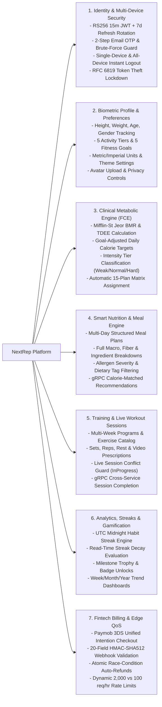

### Comprehensive Product Feature Matrix

| Domain Capability | User-Facing Product Features | Underlying Engineering & Domain Rules |
| :--- | :--- | :--- |
| **Identity, Authentication & Session Control** | - Account Registration with 6-Digit Email OTP Confirmation<br/>- Secure Login with Onboarding & Subscription State Enrichment<br/>- Seamless Background Session Renewal (Refresh Token Rotation)<br/>- 1-Step & 2-Step Password Reset via Verified OTP<br/>- Authenticated Password Change<br/>- **Single-Device Logout** vs. **"Logout All Devices"** | - **RS256 (2048-bit RSA)** asymmetric JWT signing (`15m` TTL)<br/>- **5-Strike Account Lockout** (`15m` cooldown) + **5-Attempt OTP Brute-Force Guard**<br/>- **Redis `MGET` Denylist (`< 0.3 ms`)** checking `auth:revoked:jti:{jti}` and `auth:revoked-before:{userId}`<br/>- **RFC 6819 Refresh Token Theft Detection** revoking all user sessions on replay of a rotated token |
| **Biometric Onboarding & User Preferences** | - Personal Profile Management (Name, Email, Phone, Avatar Image)<br/>- Biometric Onboarding (Age `16–100`, Gender, Height `140–220 cm`, Weight `40–200 kg`)<br/>- Localization (`en`/`ar`), UI Theme (`light`/`dark`), Measurement Units (`kg`/`cm`/`km`)<br/>- Granular Notification & Privacy Toggles | - Autonomous profile provisioning via `UserRegisteredEvent`<br/>- Cached premium badge synchronization (`IsPremiumCached`) via `SubscriptionUpgradedEvent` & `SubscriptionExpiredEvent`<br/>- Exposes synchronous `ProfileGrpc` server for sub-millisecond onboarding status checks |
| **Metabolic Calculation & Plan Prescription (FCE)** | - Clinical **Basal Metabolic Rate (BMR)** & **Total Daily Energy Expenditure (TDEE)**<br/>- 5 Activity Tiers: `Rookie (1.20)` to `TrueBeast (1.90)`<br/>- 5 Fitness Goals: `Lose Weight (-500 kcal)`, `Get Fitter (0)`, `Gain Weight (+300)`, `Gain More Flexible (+150)`, `Learn the Basic (0)`<br/>- Automatic Workout Plan Prescription across **15 specialized programs** (`LW-W` through `LTB-H`)<br/>- Immutable Plan Assignment History & Audit Trail | - Pure deterministic [`MetabolicCalculator`](./FitnessCalculationService/Domain/Services/MetabolicCalculator.cs) implementing the **Mifflin-St Jeor Equation**<br/>- Classifies daily intake into `Weak (<= 1800 kcal)`, `Normal (1800.01–2500 kcal)`, or `Hard (> 2500 kcal)`<br/>- Event-driven recalculation on `WeightUpdatedEvent` with monotonic watermark guards (`LastWeightEventAt`) to ignore out-of-order messages |
| **Nutrition & Macro Recommendation Engine** | - Paginated Multi-Day Meal Plan Catalog<br/>- Calorie-Targeted Meal Plan Discovery<br/>- Rich Meal Details: Calories, Protein, Carbs, Fats, Fiber, Prep/Cook Time, Step-by-Step Instructions<br/>- Allergen Warnings with Severity Levels & Dietary Tags (`Keto`, `Vegan`, `High-Protein`)<br/>- **Personalized Meal Recommendations** filtered by Meal Type (`Breakfast`, `Lunch`, `Dinner`, `Snack`), Max Calories, and Min Protein | - Real-time synchronous gRPC call (`CalorieTargetService.GetUserMetrics`) to `FitnessCalculationService` to fetch the athlete's exact daily calorie budget<br/>- Protected by **Polly Exponential Backoff Retry + Circuit Breaker** policies (`GrpcPolicies.cs`) |
| **Workout Catalog & Live Session Tracking** | - Multi-Week Structured Workout Plans (`Beginner`, `Intermediate`, `Advanced`)<br/>- Category-Based Workout Filtering (`Strength`, `Cardio`, `HIIT`, `Mobility`)<br/>- Biomechanics Exercise Library with Target Muscle Groups, Equipment & Video Guides<br/>- **Live Workout Session Tracker** (`POST /api/v1/sessions/start` & `/complete`) | - Active-session conflict guard inside `IUnitOfWork` prevents an athlete from starting two concurrent `InProgress` workout sessions<br/>- Exposes `WorkoutSessionGrpcService.CompleteSession` so `ProgressTrackingService` can atomically verify and complete live sessions during workout logging |
| **Progress Analytics, Streaks & Gamification** | - Workout Completion Logging (Duration, Calories Burned, Difficulty, Rating, Exercise Sets/Reps/Weights)<br/>- Chronological Weight Logging with automatic **BMI** & **Total Weight Lost** derivation<br/>- **Daily Habit Streak Tracker** (`CurrentStreak`, `LongestStreak`)<br/>- **Gamified Milestone Achievements** (`TotalWorkouts`, `StreakDays`, `TotalCalories`, `WeightLostKg`)<br/>- **Period-Over-Period Analytics Dashboards** (`week`, `month`, `year`, `all`, `custom`) with percentage trend comparisons | - Pure domain engines: [`StreakCalculator`](./ProgressTrackingService/Common/Domain/StreakCalculator.cs), [`BmiCalculator`](./ProgressTrackingService/Common/Domain/BmiCalculator.cs), [`PeriodResolver`](./ProgressTrackingService/Common/Domain/PeriodResolver.cs), and [`AchievementRuleEvaluator`](./ProgressTrackingService/Common/Domain/AchievementRuleEvaluator.cs)<br/>- **Read-Time Streak Decay (`EffectiveCurrent`):** reports `0` when `LastWorkoutDate < Today - 1` without requiring costly midnight batch writes<br/>- **Cache-Aside + Post-Commit Redis Invalidation** (`pts:dashboard:*`, `pts:stats:*`) |
| **Subscription Billing, Paymob Checkout & Edge QoS** | - Subscription Status Inspection (`Free` vs. `Premium`, `Active`, `Cancelled`, `Expired`, `Refunded`)<br/>- Multi-Duration Premium Plans (`1`, `3`, `6`, or `12` months in EGP)<br/>- Native **Paymob 3DS Unified Checkout** (Cards, Meeza, Mobile Wallets)<br/>- Non-Destructive Cancellation (disables `AutoRenew` while preserving paid access until `ExpiresAtUtc`)<br/>- **Automatic Duplicate-Charge Refunds** & **Explicit Customer Refunds** | - **Idempotency-Key** protection on checkout intention creation<br/>- **20-Field Lexicographical HMAC-SHA512** webhook verification via `CryptographicOperations.FixedTimeEquals`<br/>- **Outbox-Driven Refund Saga** (`ProcessPaymobRefundConsumer` + `PendingRefundSweeper`)<br/>- **Dynamic Gateway Rate Limiting:** `100 req/hr` (Free) vs. `2,000 req/hr` (Premium) enforced at `ApiGateway` |

---

## 2. Business Workflows & Domain State Machines

### 2.1 End-to-End Athlete Journey (6-Stage Lifecycle Graph)

The diagram below traces how an athlete's actions flow across all 7 domain microservices and the API Gateway from day-one registration to daily training and premium subscription upgrades:

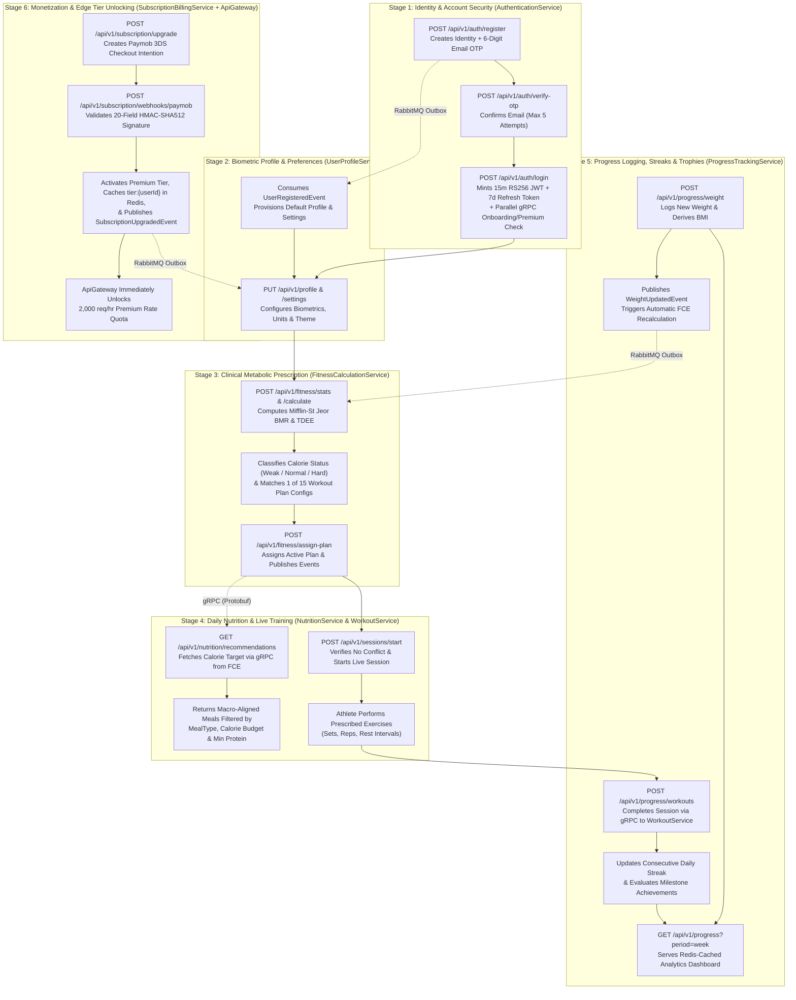

---

### 2.2 Clinical Metabolic Engine & 15-Plan Prescription Decision Graph

`FitnessCalculationService` uses a deterministic mathematical pipeline to convert raw biometrics into daily caloric targets and automatically prescribe or adapt the athlete's training program:

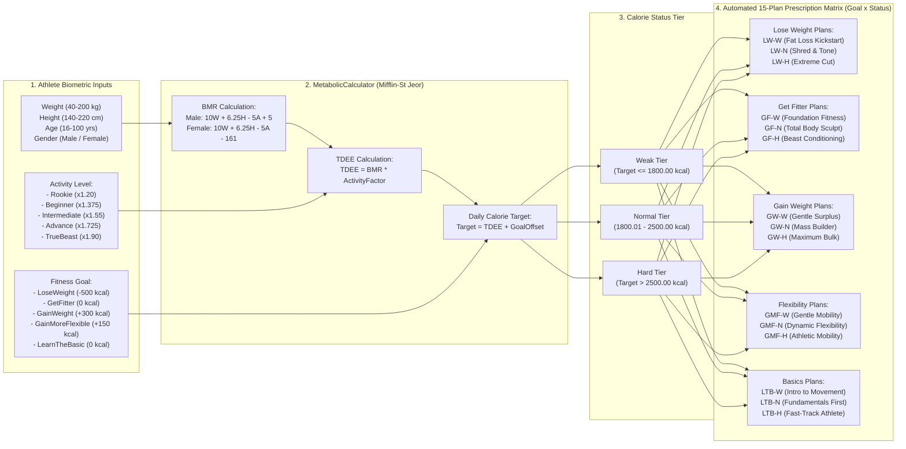

---

### 2.3 Live Workout Session, Habit Streak & Gamification State Machine

When an athlete starts and completes a workout, `WorkoutService` and `ProgressTrackingService` coordinate across state boundaries to enforce session integrity, compute UTC calendar streaks, handle read-time streak decay, and award milestone achievements:

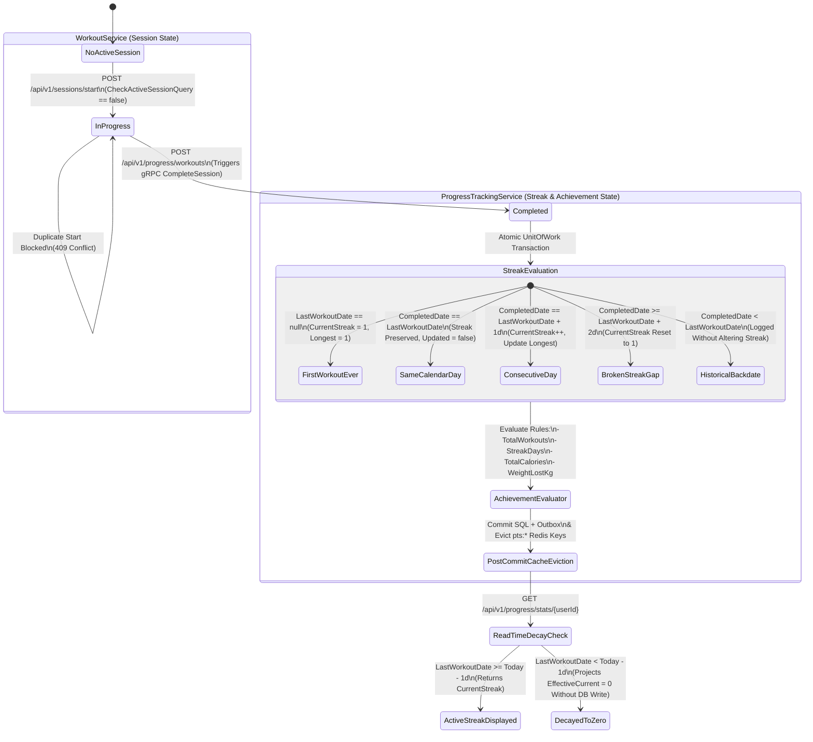

---

### 2.4 Subscription Billing, Renewal & Auto-Refund Lifecycle State Machine

`SubscriptionBillingService` models every subscription and payment attempt through a deterministic fintech state machine with optimistic concurrency (`RowVersion`), idempotency keys, background sweepers, and automatic duplicate-charge refunds:

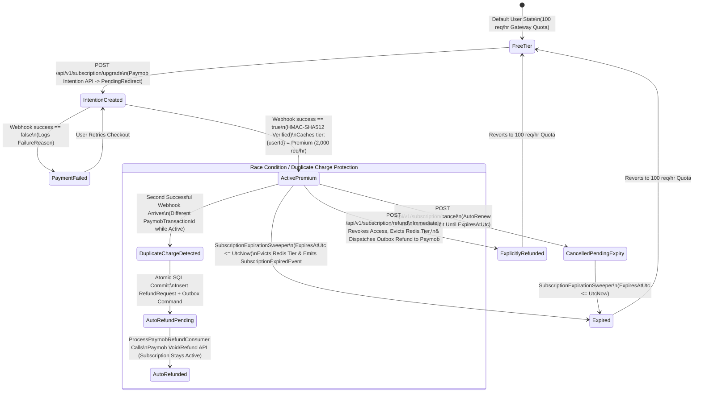

---

## 3. Technical & Distributed Systems Architecture Graphs

### 3.1 High-Level Cloud-Native System Topology

All external traffic enters through **`ApiGateway` (Port `5000`)**, which enforces edge security and rate limiting before routing requests to the 7 isolated microservices:

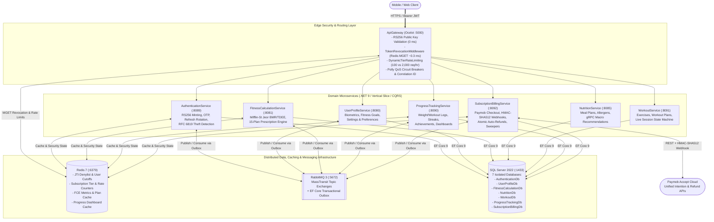

---

### 3.2 API Gateway Edge Security & Dynamic Rate-Limiting Pipeline

Every HTTP request arriving at `ApiGateway` passes through a 6-stage deterministic middleware pipeline before reaching any downstream container:

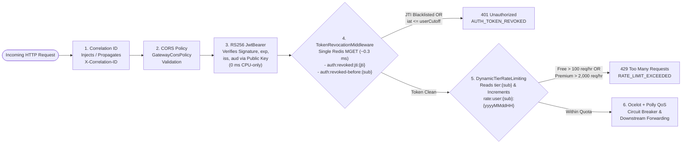

---

### 3.3 Internal Microservice Architecture (Vertical Slice + CQRS + Outbox)

Instead of traditional N-tier horizontal layers (`Controllers -> MegaServices -> Repositories`), every microservice in NextRep is structured around **Vertical Feature Slices** with **MediatR Orchestrators**, **Pure Domain Calculators**, and **Unit of Work Transaction Savepoints**:

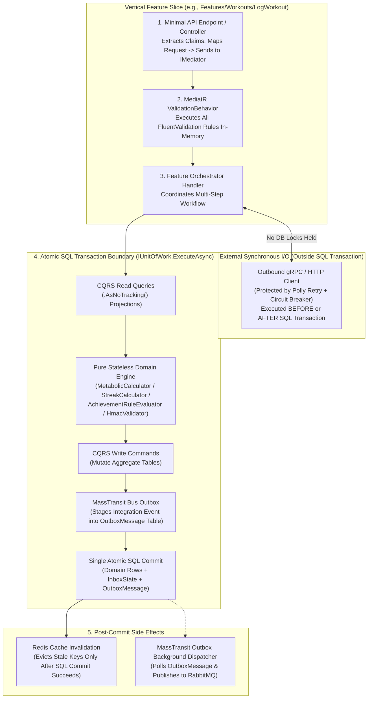

---

### 3.4 Distributed Redis Keyspace & Multi-Layer Caching Topology

Redis 7 (`StackExchange.Redis`) serves four distinct architectural roles across NextRep, partitioned by key prefix and TTL strategy:

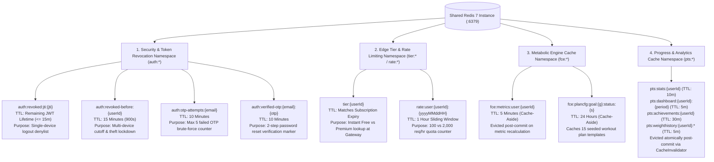

---

## 4. Inter-Service Communication Graphs (RabbitMQ & gRPC)

NextRep separates **asynchronous state propagation** (event-driven choreography via RabbitMQ) from **synchronous real-time queries/commands** (gRPC over HTTP/2).

### 4.1 Asynchronous Event-Driven Choreography (RabbitMQ + MassTransit Outbox/Inbox)

Every event below is persisted inside the producer's SQL Server `OutboxMessage` table within the same database transaction as the domain entity mutation, and deduplicated by the consumer's `InboxState` table:

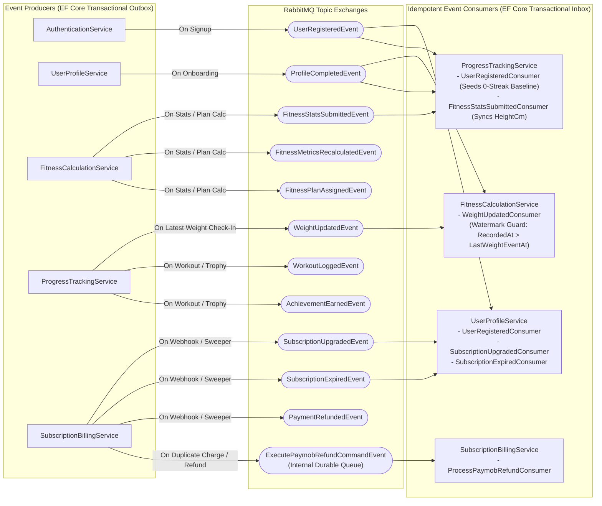

#### Complete Integration Event Catalog

| Event / Message Contract | Producer | Consumer(s) | Business Purpose & Idempotency Mechanism |
| :--- | :--- | :--- | :--- |
| `UserRegisteredEvent` | `AuthenticationService` | `UserProfileService`, `ProgressTrackingService` | Provisions default `UserProfile` + `UserSettings` rows and initializes baseline `UserStatistics` / `Streaks` records (`0` workouts, `0` streak). |
| `ProfileCompletedEvent` | `UserProfileService` | `FitnessCalculationService`, `ProgressTrackingService` | Signals completion of biometric onboarding so downstream services can initialize metabolic targets and progress tracking. |
| `FitnessStatsSubmittedEvent` | `FitnessCalculationService` | `ProgressTrackingService` | Synchronizes the athlete's `HeightCm` into `UserBiometrics` so `ProgressTrackingService` can compute accurate BMI values on every weight check-in. |
| `FitnessMetricsRecalculatedEvent` | `FitnessCalculationService` | *Topic Subscribers* | Broadcasts updated BMR, TDEE, Daily Calorie Target, and Calorie Status Tier whenever metrics are recalculated. |
| `FitnessPlanAssignedEvent` | `FitnessCalculationService` | *Topic Subscribers* | Broadcasts newly assigned or adapted workout plan (`PlanId`, `Goal`, `Status`) when an athlete's calorie tier shifts. |
| `WeightUpdatedEvent` | `ProgressTrackingService` | `FitnessCalculationService` | Triggered when a chronologically newest weigh-in is logged; causes FCE to recalculate BMR/TDEE and adapt the active plan if the intensity tier changed. Protected by `LastWeightEventAt` watermark. |
| `WorkoutLoggedEvent` | `ProgressTrackingService` | *Topic Subscribers* | Emitted atomically when a workout session is logged and streaks are updated. |
| `AchievementEarnedEvent` | `ProgressTrackingService` | *Topic Subscribers* | Emitted whenever `AchievementRuleEvaluator` unlocks a new milestone trophy badge. |
| `SubscriptionUpgradedEvent` | `SubscriptionBillingService` | `UserProfileService` | Updates `IsPremiumCached = true` on `UserProfile` upon verified Paymob payment. |
| `SubscriptionExpiredEvent` | `SubscriptionBillingService` | `UserProfileService` | Updates `IsPremiumCached = false` when `SubscriptionExpirationSweeper` transitions an expired subscription. |
| `ExecutePaymobRefundCommandEvent` | `SubscriptionBillingService` | `SubscriptionBillingService` | Durable internal outbox command that executes Paymob HTTP refunds (`POST /api/acceptance/void_refund/refund`) with retry tracking and `PendingRefundSweeper` backup. |
| `PaymentRefundedEvent` | `SubscriptionBillingService` | *Topic Subscribers* | Audit notification emitted after `ProcessPaymobRefundConsumer` confirms a completed Paymob refund transaction. |

---

### 4.2 Synchronous High-Performance RPC Mesh (gRPC over HTTP/2 + Polly)

When a microservice requires immediate data or state verification from another bounded context during an active HTTP request, it uses **gRPC (Protocol Buffers over HTTP/2)** wrapped in **Polly resilience pipelines**:

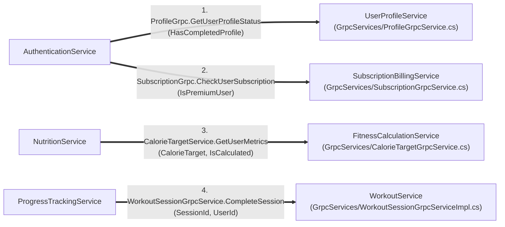

| # | gRPC Client (Caller) | gRPC Server (Callee) | Proto Contract | Purpose & Resilience Strategy |
| :- | :--- | :--- | :--- | :--- |
| **1** | `AuthenticationService` | `UserProfileService` | `ProfileGrpc.GetUserProfileStatus` | Enriches the login response with `hasCompletedProfile` so the client app knows whether to route to Onboarding or Home. Runs **outside** the SQL transaction; falls back to `false` on timeout. |
| **2** | `AuthenticationService` | `SubscriptionBillingService` | `SubscriptionGrpc.CheckUserSubscription` | Enriches the login response with `isPremium`. Executed concurrently with #1 via `Task.WhenAll` outside the SQL lock. |
| **3** | `NutritionService` | `FitnessCalculationService` | `CalorieTargetService.GetUserMetrics` | Retrieves the user's calculated daily calorie target to recommend macro-aligned meals. Protected by Polly retry (`3 attempts`) + circuit breaker (`GrpcPolicies.cs`). |
| **4** | `ProgressTrackingService` | `WorkoutService` | `WorkoutSessionGrpcService.CompleteSession` | Synchronously verifies session ownership and transitions an `InProgress` `WorkoutSession` to `Completed` before recording workout logs, updating streaks, and awarding achievements. |

---

## 5. Hard Distributed Systems & Security Engineering Challenges Solved

### 5.1 RS256 Asymmetric JWTs & Sub-Millisecond (`< 0.3 ms`) Hybrid Redis Token Revocation

#### The Architectural Problem
In a distributed microservices platform, verifying tokens by calling `AuthenticationService` on every HTTP request creates a **Single Point of Failure (SPOF)** and adds `10–25 ms` of network/SQL latency to every API call.
To avoid this, NextRep uses **RS256 (RSA Signature with SHA-256)**:
- Only `AuthenticationService` holds the **2048-bit RSA Private Key** (`auth-service-private.pem`) to mint tokens.
- `ApiGateway` and all downstream microservices hold the **read-only RSA Public Key** (`auth-service-public.pem`) to verify token signatures **100% locally in CPU memory (`0 ms`)**.

**However, pure stateless JWTs have a critical security flaw:** if a user logs out, changes their password after a breach, or has their token stolen, a traditional stateless JWT **remains completely valid across every microservice until its `exp` timestamp expires.**

#### How We Solved It (Hybrid #1 + #2 + #3 Pipeline)
We engineered a **3-layer hybrid revocation architecture** shared between `AuthenticationService` and `ApiGateway` via Redis:

1. **Short-Lived Access Token TTL (`15 Minutes`):** Bounds the maximum lifetime of any Redis denylist key to at most 900 seconds, keeping Redis memory consumption under **`1 MB` even at 10,000 concurrent logouts**.
2. **Per-Token `jti` Denylist (`auth:revoked:jti:{jti}`):** When a user calls `POST /api/v1/auth/logout`, [`LogoutOrchestratorHandler`](./AuthenticationService/Features/Auth/Orchestrators/Logout/LogoutOrchestratorHandler.cs) extracts the token's unique `jti` (`JwtRegisteredClaimNames.Jti`) and remaining lifetime (`exp - UtcNow`), writing `SET auth:revoked:jti:{jti} "1" EX <remainingSeconds>`. This revokes that specific device immediately without kicking the user off their other devices.
3. **Per-User Timestamp Cutoff (`auth:revoked-before:{userId}`):** When a user calls `POST /api/v1/auth/logout-all`, changes their password, resets their password, or triggers refresh-token theft detection, [`RedisTokenRevocationStore`](./AuthenticationService/Services/RedisTokenRevocationStore.cs) writes `SET auth:revoked-before:{userId} "<nowUnixSeconds>" EX 900`. Any JWT for that user whose `iat` (*Issued At*) claim is `<= cutoffUnix` is rejected across the entire platform in $O(1)$ time.
4. **Single-Roundtrip Atomic `MGET` at `ApiGateway`:** On every authenticated request, [`TokenRevocationMiddleware`](./ApiGateway/Middleware/TokenRevocationMiddleware.cs) batches both checks into a **single Redis `MGET` network packet (`~0.3 ms`)**:

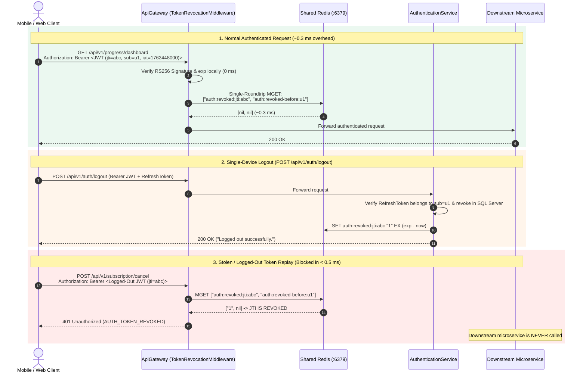

---

### 5.2 RFC 6819 Refresh Token Reuse / Theft Detection & Multi-Device Session Cutoffs

#### The Problem
If an attacker steals a user's 7-day Refresh Token and rotates it first, the old Refresh Token is marked `RevokedAt != null` in SQL Server. When the legitimate user's phone later attempts to refresh using that original token, naive implementations simply return `401 Unauthorized` to the victim while **leaving the attacker's newly rotated Refresh Token active for 7 days.**

#### Our Solution
In [`RefreshTokenOrchestratorHandler.cs`](./AuthenticationService/Features/Auth/Orchestrators/RefreshToken/RefreshTokenOrchestratorHandler.cs), if an already-revoked Refresh Token (`RevokedAt != null`) is ever presented:
1. The server immediately recognizes a **Refresh Token Replay / Theft Event (RFC 6819 Section 5.2.2.3)**.
2. It executes [`RevokeAllRefreshTokensCommand`](./AuthenticationService/Features/Auth/Commands/RevokeAllRefreshTokens/RevokeAllRefreshTokensCommandHandler.cs) to invalidate **every active Refresh Token** for that user in SQL Server.
3. It writes `auth:revoked-before:{userId} = UtcNow` to Redis, immediately invalidating the attacker's active 15-minute JWT at `ApiGateway`.
4. It returns `401 Unauthorized` with error code `AUTH_TOKEN_THEFT_DETECTED`, forcing a clean re-authentication.

---

### 5.3 Native Paymob Integration, Constant-Time HMAC-SHA512 & Atomic Auto-Refunds on Race Conditions

#### The Problem
In payment systems, a user might accidentally pay twice (e.g., opening two checkout tabs or retrying a slow mobile connection), or a payment gateway might deliver two concurrent `TRANSACTION` webhooks for separate payment intentions. If the user's subscription was already activated by Transaction #1, simply ignoring Transaction #2 leaves the customer **double-charged in real money** with no extra subscription value.

#### Our Solution
In [`ProcessPaymobWebhookOrchestrator.cs`](./SubscriptionBillingService/Features/Subscriptions/Orchestrators/ProcessPaymobWebhookOrchestrator.cs):
1. **Cryptographic Webhook Authenticity:** [`PaymobHmacValidator`](./SubscriptionBillingService/Infrastructure/Paymob/PaymobHmacValidator.cs) extracts the 20 required Paymob transaction fields in strict lexicographical order, computes the `HMAC-SHA512` digest, and compares bytes using **`CryptographicOperations.FixedTimeEquals`** to prevent timing side-channel attacks.
2. **Idempotency vs. Duplicate-Charge Detection:**
   - If the *same* `ProviderTransactionId` arrives twice (webhook retry), it returns `200 OK` idempotently.
   - If a *different* successful `ProviderTransactionId` arrives for a user whose subscription is **already `Active` with `ExpiresAtUtc > UtcNow`**, the orchestrator detects a **Duplicate Charge Race Condition**:
     - Inside the **same `IUnitOfWork` SQL transaction**, it marks the `PaymentAttempt` as `DuplicateChargePendingRefund`, creates a `RefundRequest` (`Reason = DuplicateActiveSubscription`, `AmountCents`), writes an audit `BillingLog`, and stages `ExecutePaymobRefundCommandEvent` in the MassTransit Outbox.
     - [`ProcessPaymobRefundConsumer`](./SubscriptionBillingService/Features/Subscriptions/Consumers/ProcessPaymobRefundConsumer.cs) + [`PendingRefundSweeper`](./SubscriptionBillingService/Features/Subscriptions/Sweepers/PendingRefundSweeper.cs) automatically refund the user's card via Paymob's `/api/acceptance/void_refund/refund` endpoint.

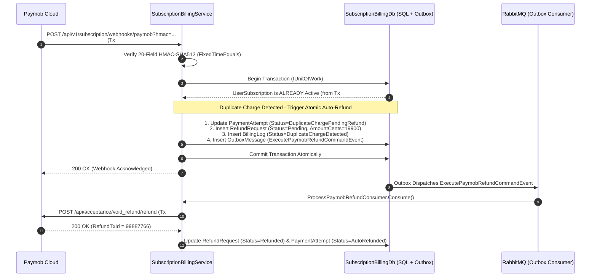

---

### 5.4 Eliminating Dual-Write Bugs via the MassTransit EF Core Transactional Outbox

A classic microservices anti-pattern is calling `await _dbContext.SaveChangesAsync()` followed by `await _publishEndpoint.Publish(event)`. If the RabbitMQ broker is momentarily unreachable or the container crashes between those two lines, the database is updated but downstream services never receive the event (**inconsistent zombie state**).

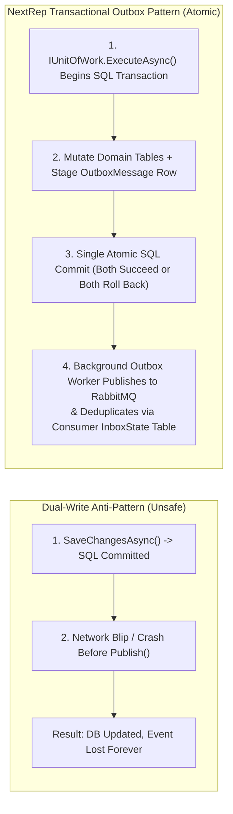

---

### 5.5 Dynamic Subscription-Tier Rate Limiting at the Edge (`ApiGateway`)

Rather than applying a static rate limit to all users, [`DynamicTierRateLimitingMiddleware`](./ApiGateway/Middleware/DynamicTierRateLimitingMiddleware.cs) in `ApiGateway` inspects the user's live subscription tier in Redis (`tier:{userId}`) and enforces hourly sliding-window quotas (`rate:user:{userId}:{yyyyMMddHH}`):
- **Free Tier:** `100 requests / hour`
- **Premium Tier:** `2,000 requests / hour` (unlocked immediately when `SubscriptionBillingService` caches `tier:{userId} = "Premium"` upon payment)
- Every response includes `X-RateLimit-Limit`, `X-RateLimit-Remaining`, and `X-RateLimit-Tier` headers.

---

### 5.6 Decoupling External gRPC Network I/O from SQL Server Transactions

During our security and performance audit of [`LoginOrchestratorHandler.cs`](./AuthenticationService/Features/Auth/Orchestrators/Login/LoginOrchestratorHandler.cs), we identified that calling `UserProfileService` and `SubscriptionBillingService` via gRPC *inside* `_unitOfWork.ExecuteAsync` held SQL Server row locks open on `Users`, `LoginAttempts`, and `RefreshTokens` for the duration of external network I/O.
We refactored `LoginOrchestratorHandler` so the SQL transaction commits and releases its connection back to the pool **first**, and then executes both read-only gRPC enrichment calls concurrently via `Task.WhenAll` outside the transaction boundary.

---

## 6. Database-per-Service SQL Server Architecture (Complete ER Diagrams)

NextRep enforces strict **Database-per-Service** encapsulation on SQL Server 2022. Cross-service relationships are linked logically by `UserId (Guid)` and synchronized via integration events or gRPC.

```mermaid
erDiagram
    %% 1. AuthenticationDb
    AUTH_Users ||--o{ AUTH_RefreshTokens : "has sessions"
    AUTH_Users {
        string Id PK "GUID"
        string Email UK
        string PasswordHash
        bool EmailConfirmed
        bool IsLockedOut
        datetime LockedUntil
    }
    AUTH_RefreshTokens {
        int Id PK
        string UserId FK
        string Token
        datetime ExpiresAt
        datetime CreatedAt
        datetime RevokedAt "Nullable (RFC 6819 Theft Check)"
    }
    AUTH_OtpCodes {
        int Id PK
        string Email
        string Code "6-Digit OTP"
        bool IsUsed
        datetime ExpiresAt
    }
    AUTH_LoginAttempts {
        int Id PK
        string Email
        string IpAddress "X-Forwarded-For"
        bool IsSuccess
        datetime AttemptedAt
    }

    %% 2. UserProfileDb
    PROFILE_UserProfiles ||--o| PROFILE_UserSettings : "configures"
    PROFILE_UserProfiles {
        int Id PK
        string FirstName
        string LastName
        string Email UK
        string PhoneNumber
        string ProfilePictureUrl
        bool IsPremiumCached
        datetime MemberSince
    }
    PROFILE_UserSettings {
        int Id PK,FK
        string Language "en | ar"
        string Theme "light | dark"
        string NotificationSettings "JSON"
        string PrivacySettings "JSON"
        string UnitSettings "JSON"
    }

    %% 3. FitnessCalculationDb
    FCE_UserFitnessStats ||--o{ FCE_CalculatedMetrics : "source snapshot"
    FCE_CalculatedMetrics ||--o{ FCE_UserAssignedPlan : "determines status"
    FCE_FitnessPlanConfig ||--o{ FCE_UserAssignedPlan : "prescribes"
    FCE_UserAssignedPlan ||--o{ FCE_UserPlanHistory : "audited by"
    FCE_UserFitnessStats {
        uuid Id PK
        uuid UserId
        float Weight "40-200 kg"
        float Height "140-220 cm"
        int Age "16-100 yrs"
        int Gender "Male | Female"
        int Goal "0-4"
        int ActivityLevel "0-4"
        datetime RecordedAt
    }
    FCE_CalculatedMetrics {
        uuid Id PK
        uuid UserId UK
        float Bmr "Mifflin-St Jeor"
        float Tdee
        float CalorieTarget
        int Status "Weak | Normal | Hard"
        datetime LastWeightEventAt "Idempotency Watermark"
        binary RowVersion
    }
    FCE_FitnessPlanConfig {
        uuid Id PK
        string PlanId UK "LW-W .. LTB-H (15 Plans)"
        string Name
        int Goal
        int Status
        int WorkoutsPerWeek
        int EstimatedDurationWeeks
    }
    FCE_UserAssignedPlan {
        uuid Id PK
        uuid UserId
        uuid FitnessPlanConfigId FK
        bool IsActive
        datetime AssignedAt
    }
    FCE_UserPlanHistory {
        uuid Id PK
        uuid UserId
        string PlanId
        string PreviousPlanId
        string TriggeredBy
        datetime ChangedAt
    }

    %% 4. SubscriptionBillingDb
    SUB_PaymentAttempts ||--o{ SUB_BillingLogs : "has audit trail"
    SUB_PaymentAttempts ||--o| SUB_RefundRequests : "triggers refund"
    SUB_UserSubscriptions {
        guid Id PK
        guid UserId UK
        string Tier "Free | Premium"
        string Status "Active | Cancelled | Expired | Refunded"
        int PlanDurationMonths "1 | 3 | 6 | 12"
        bool AutoRenew
        datetime StartedAtUtc
        datetime ExpiresAtUtc
        byte[] RowVersion
    }
    SUB_PaymentAttempts {
        guid Id PK
        guid UserId
        string IdempotencyKey UK
        int AmountCents
        string Currency "EGP"
        string Status "Initiated | PendingRedirect | Succeeded | AutoRefunded"
        string ProviderIntentionId
        string ProviderTransactionId
        byte[] RowVersion
    }
    SUB_RefundRequests {
        guid Id PK
        guid PaymentAttemptId FK
        guid UserId
        string ProviderTransactionId UK
        string ProviderRefundTransactionId
        int AmountCents
        string Reason "DuplicateActiveSubscription | ExplicitSubscriptionRefund"
        string Status "Pending | Refunded | FailedManualIntervention"
        int RetryCount
    }
    SUB_BillingLogs {
        guid Id PK
        guid UserId
        guid PaymentAttemptId FK
        decimal Amount
        string ProviderTransactionId UK
        string PaymentStatus
        datetime CreatedAt
    }
```

```mermaid
erDiagram
    %% 5. NutritionDb
    NUT_MealPlans ||--o{ NUT_MealPlanItems : "schedules"
    NUT_Meals ||--o{ NUT_MealPlanItems : "assigned to"
    NUT_Meals ||--o{ NUT_MealIngredients : "contains"
    NUT_Ingredients ||--o{ NUT_MealIngredients : "measured in"
    NUT_Meals ||--o{ NUT_MealAllergens : "flags"
    NUT_Allergens ||--o{ NUT_MealAllergens : "warns"
    NUT_Meals ||--o{ NUT_MealTags : "categorized by"
    NUT_Tags ||--o{ NUT_MealTags : "labels"
    NUT_Meals {
        guid Id PK
        string Name
        string MealType "Breakfast | Lunch | Dinner | Snack"
        int Calories
        decimal ProteinGrams
        decimal CarbsGrams
        decimal FatsGrams
        decimal FiberGrams
        int PrepTimeMinutes
    }
    NUT_MealPlans {
        guid Id PK
        string Name
        int TargetCalories
        string GoalCategory
        int DurationDays
    }
    NUT_MealPlanItems {
        guid Id PK
        guid MealPlanId FK
        guid MealId FK
        int DayNumber
    }
    NUT_Ingredients {
        guid Id PK
        string Name
        string Category
    }
    NUT_MealIngredients {
        guid MealId PK,FK
        guid IngredientId PK,FK
        decimal Quantity
        string Unit
    }
    NUT_Allergens {
        guid Id PK
        string Name
        string Severity
    }
    NUT_MealAllergens {
        guid MealId PK,FK
        guid AllergenId PK,FK
    }
    NUT_Tags {
        guid Id PK
        string Name
    }
    NUT_MealTags {
        guid MealId PK,FK
        guid TagId PK,FK
    }

    %% 6. WorkoutDb
    WRK_WorkoutPlans ||--o{ WRK_Workouts : "includes"
    WRK_Workouts ||--o{ WRK_WorkoutExercises : "prescribes"
    WRK_Exercises ||--o{ WRK_WorkoutExercises : "performed in"
    WRK_Workouts ||--o{ WRK_WorkoutSessions : "tracked by"
    WRK_WorkoutPlans {
        guid Id PK
        string Name
        string DifficultyLevel
        int DurationWeeks
    }
    WRK_Workouts {
        guid Id PK
        guid WorkoutPlanId FK
        string Name
        string Category "Strength | Cardio | HIIT | Mobility"
        int EstimatedDurationMinutes
    }
    WRK_Exercises {
        guid Id PK
        string Name
        string TargetMuscleGroup
        string Equipment
    }
    WRK_WorkoutExercises {
        guid Id PK
        guid WorkoutId FK
        guid ExerciseId FK
        int Sets
        int Reps
        int RestSeconds
        int OrderIndex
    }
    WRK_WorkoutSessions {
        guid Id PK
        guid UserId
        guid WorkoutId FK
        string Status "InProgress | Completed"
        datetime StartedAt
        datetime CompletedAt
    }

    %% 7. ProgressTrackingDb
    PRG_WorkoutLogs ||--o{ PRG_WorkoutLogExercises : "contains"
    PRG_Achievements ||--o{ PRG_UserAchievements : "awarded as"
    PRG_WorkoutLogs {
        guid Id PK
        guid UserId
        guid WorkoutId
        string SessionId UK
        datetime CompletedAt
        int DurationInMinutes
        int CaloriesBurned
        string Difficulty
        int Rating
    }
    PRG_WorkoutLogExercises {
        guid Id PK
        guid WorkoutLogId FK
        guid ExerciseId
        int SetsCompleted
        int RepsCompleted
        double WeightUsed
    }
    PRG_WeightHistory {
        guid Id PK
        guid UserId
        double Weight
        datetime Date
    }
    PRG_UserStatistics {
        guid UserId PK
        int TotalWorkouts
        int TotalCaloriesBurned
        int TotalMinutes
        double InitialWeight
        double CurrentWeight
        double TotalWeightLost
    }
    PRG_Streaks {
        guid UserId PK
        int CurrentStreak
        int LongestStreak
        datetime LastWorkoutDate
        rowversion RowVersion
    }
    PRG_Achievements {
        guid Id PK
        string Code UK
        string Name
        string CriteriaType
        double Threshold
    }
    PRG_UserAchievements {
        guid Id PK
        guid UserId
        guid AchievementId FK
        datetime EarnedAt
    }
    PRG_UserBiometrics {
        guid UserId PK
        double HeightCm
    }
```

---

## 7. CI/CD Quality Gate & Container Delivery Pipeline

NextRep enforces an automated build, test, coverage, and container publishing pipeline in [`.github/workflows/production.yml`](./.github/workflows/production.yml). No Docker image can be built or pushed to Docker Hub unless all **225 automated tests** pass.

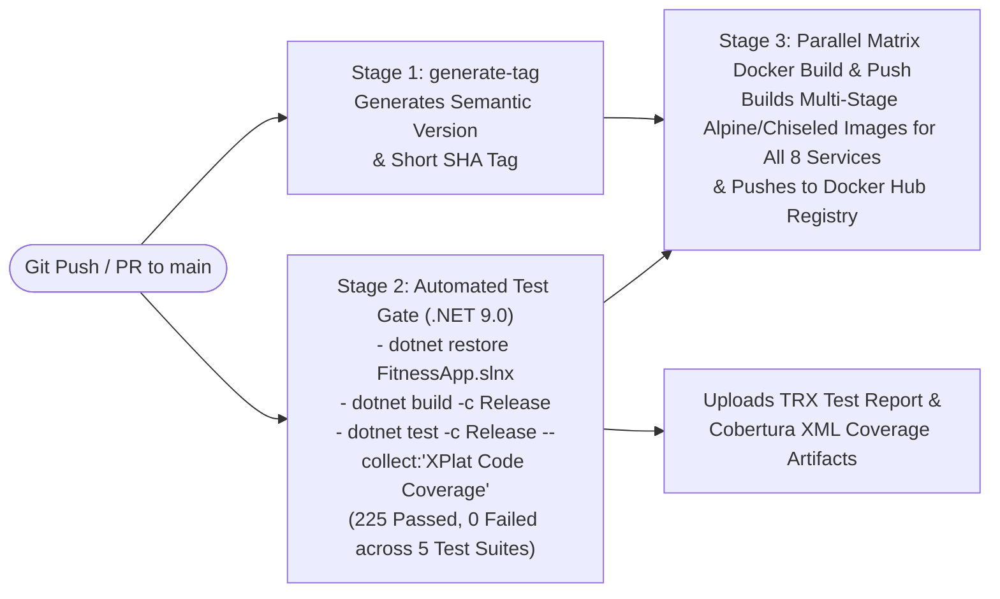

---

## 8. Microservice Catalog & Service-Specific Documentation

Every service in the repository includes its own dedicated, deep-dive `README.md` with API endpoint tables, internal architecture diagrams, database configurations, and local execution instructions:

| Service | Host Port | Database | Core Responsibility | Documentation |
| :--- | :---: | :--- | :--- | :---: |
| **1. `ApiGateway`** | `:5000` | *Stateless (Redis)* | Ocelot Reverse Proxy, RS256 Edge Validation, `< 0.3 ms` Redis `MGET` Token Revocation, Dynamic Tier Rate Limiting (`100` vs `2,000 req/hr`), Polly QoS. | [Read Docs](./ApiGateway/README.md) |
| **2. `AuthenticationService`** | `:8089` | `AuthenticationDb` | RS256 JWT Issuance (`15m` TTL), Refresh Token Rotation & RFC 6819 Theft Detection, Redis `jti` Denylist & User Cutoff Store, 2-Step OTP Flow with Brute-Force Protection, Parallel gRPC Login Enrichment. | [Read Docs](./AuthenticationService/README.md) |
| **3. `UserProfileService`** | `:8080` | `UserProfileDb` | Biometric Onboarding, Fitness Goal Management, Dietary Preferences, Profile Completion State Machine, gRPC Profile Status Server, Event-Driven Weight & Subscription Sync. | [Read Docs](./UserProfileService/README.md) |
| **4. `FitnessCalculationService`** | `:8081` | `FitnessCalculationDb` | Mifflin-St Jeor BMR & TDEE Engine, Goal-Based Calorie & Macro Split Calculator, Automated 15-Plan Fitness Prescription Matrix, Redis L2 Cache, gRPC Calorie Target Server. | [Read Docs](./FitnessCalculationService/README.md) |
| **5. `NutritionService`** | `:8085` | `NutritionDb` | Curated Meal Plans, Ingredient & Allergen Graphs, Calorie-Filtered Meal Browsing, Personalized Meal Recommendations powered by gRPC calls to `FitnessCalculationService`. | [Read Docs](./NutritionService/README.md) |
| **6. `WorkoutService`** | `:8091` | `WorkoutDb` | Exercise Catalog, Structured Multi-Week Workout Plans, Category Filtering, Live Workout Session State Machine (`Start` $\rightarrow$ `Complete`), gRPC Session Completion Server. | [Read Docs](./WorkoutService/README.md) |
| **7. `ProgressTrackingService`** | `:8090` | `ProgressTrackingDb` | Weight & Body Measurement Time-Series, Workout Calorie Expenditure, UTC Midnight Streak Engine with Read-Time Decay, Gamified Milestone Achievements, Redis-Cached Dashboards. | [Read Docs](./ProgressTrackingService/README.md) |
| **8. `SubscriptionBillingService`** | `:8092` | `SubscriptionBillingDb` | Native Paymob Unified Intention Checkout, 20-Field Constant-Time HMAC-SHA512 Webhook Processor, Atomic Outbox Auto-Refunds on Race Conditions, Expiration & Refund Sweepers, gRPC Subscription Server. | [Read Docs](./SubscriptionBillingService/README.md) |

---

## 9. Getting Started (Docker Compose & Local Test Suite)

### 9.1 Prerequisites
- [.NET 9.0 SDK](https://dotnet.microsoft.com/download/dotnet/9.0)
- [Docker Desktop](https://www.docker.com/products/docker-desktop/) (with Docker Compose v2)

### 9.2 Generate RSA 2048-Bit Keypair (First-Time Setup)
Because `Keys/` is gitignored for security, generate a local RSA keypair in `./Keys` before starting Docker Compose (note: automated tests generate ephemeral keys automatically via `TestRsaKeyHelper`):

```bash
mkdir -p Keys
openssl genpkey -algorithm RSA -out Keys/auth-service-private.pem -pkeyopt rsa_keygen_bits:2048
openssl rsa -pubout -in Keys/auth-service-private.pem -out Keys/auth-service-public.pem
```

### 9.3 Launch the Entire Platform with Docker Compose
```bash
docker compose up --build -d
```
Once all containers report healthy:
- **API Gateway Entrypoint:** `http://localhost:5000`
- **RabbitMQ Management UI:** `http://localhost:15672` (`guest` / `guest`)
- **Swagger UIs (Development Mode):**
  - `AuthenticationService`: `http://localhost:8089/swagger`
  - `UserProfileService`: `http://localhost:8080/swagger`
  - `FitnessCalculationService`: `http://localhost:8081/swagger`
  - `NutritionService`: `http://localhost:8085/swagger`
  - `ProgressTrackingService`: `http://localhost:8090/swagger`
  - `WorkoutService`: `http://localhost:8091/swagger`
  - `SubscriptionBillingService`: `http://localhost:8092/swagger`

### 9.4 Run the Full 225-Test Suite & Code Coverage
```bash
dotnet test FitnessApp.slnx -c Release --logger "trx;LogFileName=test_results.trx" --collect:"XPlat Code Coverage"
```

```text
Passed!  - Failed: 0, Passed:   5, Skipped: 0 - ApiGateway.dll (net9.0)
Passed!  - Failed: 0, Passed:  12, Skipped: 0 - AuthenticationService.dll (net9.0)
Passed!  - Failed: 0, Passed:  53, Skipped: 0 - FitnessCalculationService.dll (net9.0)
Passed!  - Failed: 0, Passed: 119, Skipped: 0 - ProgressTrackingService.dll (net9.0)
Passed!  - Failed: 0, Passed:  36, Skipped: 0 - SubscriptionBillingService.dll (net9.0)
--------------------------------------------------------------------------------------
Total: 225 Passed, 0 Failed, 0 Skipped
```
