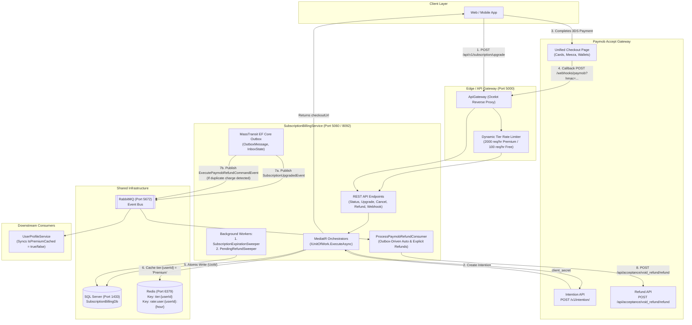
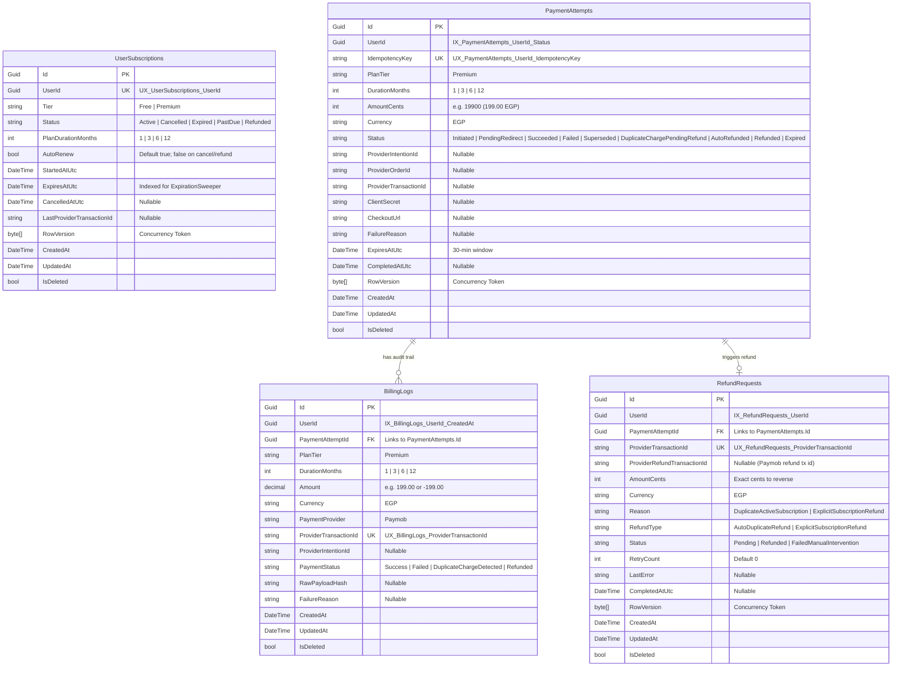
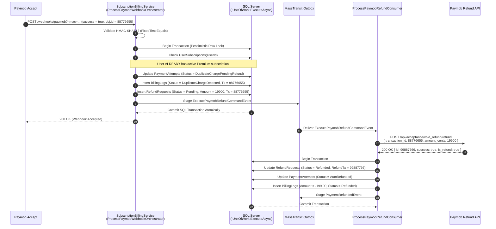

# 📦 Subscription & Billing Service (`SubscriptionBillingService`)

> **Elevate Fitness Architecture & Service Documentation**  
> **Target Framework:** .NET 9.0 (ASP.NET Core Web API)  
> **Persistence:** SQL Server (`SubscriptionBillingDb`) via Entity Framework Core 9  
> **Caching:** Redis Distributed Cache (`StackExchange.Redis`)  
> **Messaging & Outbox:** MassTransit with Entity Framework Core Outbox & RabbitMQ  
> **Payment Gateway:** 100% Native Paymob Accept (Unified Intention API + 20-field HMAC-SHA512 Webhooks + Void/Refund API)  

---

## 1. System Architecture & Topology



---

## 2. Domain Model & Database Schema

The service manages subscription lifecycle, payment attempts, immutable billing audit logs, and refund state machines:



---

## 3. Paymob Native Integration & Atomic Auto-Refund Saga

### 3.1 20-Field Lexicographical HMAC-SHA512 Verification
All incoming transaction webhooks (`POST /api/v1/subscription/webhooks/paymob?hmac=...`) are verified by concatenating these exact 20 properties in alphabetical order (booleans formatted as lowercase `"true"` or `"false"`):
1. `amount_cents`
2. `created_at`
3. `currency`
4. `error_occured`
5. `has_parent_transaction`
6. `id`
7. `integration_id`
8. `is_3d_secure`
9. `is_auth`
10. `is_capture`
11. `is_refunded`
12. `is_standalone_payment`
13. `is_voided`
14. `order.id`
15. `owner`
16. `pending`
17. `source_data.pan`
18. `source_data.sub_type`
19. `source_data.type`
20. `success`

The hash is computed with `HMACSHA512(HmacSecret)` and verified using **`CryptographicOperations.FixedTimeEquals`** to prevent side-channel timing attacks.

### 3.2 Sequence Diagram: Accidental Duplicate Payment & Atomic Auto-Refund



---

## 4. API Endpoints Reference

### 4.1 Get Subscription Status (Story 8.1)
- **Path:** `GET /api/v1/subscription/status/{userId:guid}`
- **Auth:** Bearer JWT
- **Response (200 OK — Active):**
  ```json
  {
    "data": {
      "userId": "3fa85f64-5717-4562-b3fc-2c963f66afa6",
      "tier": "Premium",
      "status": "Active",
      "autoRenew": true,
      "expiresAt": "2026-12-07T12:00:00Z"
    },
    "isSuccess": true,
    "message": "Subscription status retrieved successfully.",
    "statusCode": 200
  }
  ```
- **Response (200 OK — No subscription row exists):**
  ```json
  {
    "data": {
      "userId": "3fa85f64-5717-4562-b3fc-2c963f66afa6",
      "tier": "Free",
      "status": "None",
      "autoRenew": false,
      "expiresAt": null
    },
    "isSuccess": true,
    "statusCode": 200
  }
  ```

### 4.2 Upgrade to Premium (Story 8.2)
- **Path:** `POST /api/v1/subscription/upgrade`
- **Headers:** `Authorization: Bearer <token>`, `Idempotency-Key: <guid>`
- **Request:**
  ```json
  {
    "userId": "3fa85f64-5717-4562-b3fc-2c963f66afa6",
    "planTier": 1,
    "durationMonths": 1
  }
  ```
- **Response (200 OK — Checkout Session Created):**
  ```json
  {
    "data": {
      "paymentAttemptId": "9b1deb4d-3b7d-4bad-9bdd-2b0d7b3dcb6d",
      "providerIntentionId": "pi_123456",
      "checkoutUrl": "https://accept.paymob.com/unifiedcheckout/?publicKey=pk_test_...&clientSecret=cs_test_...",
      "clientSecret": "cs_test_...",
      "amount": 199.00,
      "currency": "EGP",
      "status": "PendingRedirect",
      "expiresAt": "2026-11-07T15:30:00Z"
    },
    "isSuccess": true
  }
  ```
- **Response (409 Conflict):** User already has active Premium subscription (`SUB_ALREADY_ACTIVE`).

### 4.3 Paymob Webhook Callback
- **Path:** `POST /api/v1/subscription/webhooks/paymob?hmac={hmac}`
- **Auth:** Anonymous (HMAC-SHA512 verified)
- **Response:** `200 OK`

### 4.4 Cancel Subscription (Story 8.3)
- **Path:** `POST /api/v1/subscription/cancel`
- **Auth:** Bearer JWT
- **Request:**
  ```json
  {
    "userId": "3fa85f64-5717-4562-b3fc-2c963f66afa6"
  }
  ```
- **Response (200 OK):** Auto-renewal turned off without truncating `expiresAt`.
- **Response (404 Not Found):** No active subscription to cancel (`RES_NOT_FOUND`).

### 4.5 Explicit Atomic Refund
- **Path:** `POST /api/v1/subscription/refund`
- **Auth:** Bearer JWT
- **Request:**
  ```json
  {
    "userId": "3fa85f64-5717-4562-b3fc-2c963f66afa6",
    "reason": "Customer requested refund within window."
  }
  ```
- **Response (200 OK):** Immediately revokes subscription, invalidates Redis tier cache, and stages Outbox refund command.

---

## 5. Background Workers (Sweepers)

1. **`SubscriptionExpirationSweeper`:**
   - Runs every 5 minutes (`PeriodicTimer`).
   - Identifies subscriptions where `Status == Active` and `ExpiresAtUtc <= UtcNow`.
   - Transitions `Status = Expired`, deletes `tier:{userId}` from Redis, and stages `SubscriptionExpiredEvent`.
2. **`PendingRefundSweeper`:**
   - Runs every 5 minutes.
   - Dispatches any `Pending` refund requests older than 2 minutes to ensure no transient failure prevents a customer refund.

---

## 6. Running & Verification Commands

```bash
# Build the project
dotnet build SubscriptionBillingService/SubscriptionBillingService.csproj

# Run all test suites
dotnet test SubscriptionBillingService/SubscriptionBillingService.csproj -c Release

# Run entire solution test suite
dotnet test FitnessApp.slnx -c Release --no-restore --logger "trx;LogFileName=test_results.trx" --collect:"XPlat Code Coverage"
```
