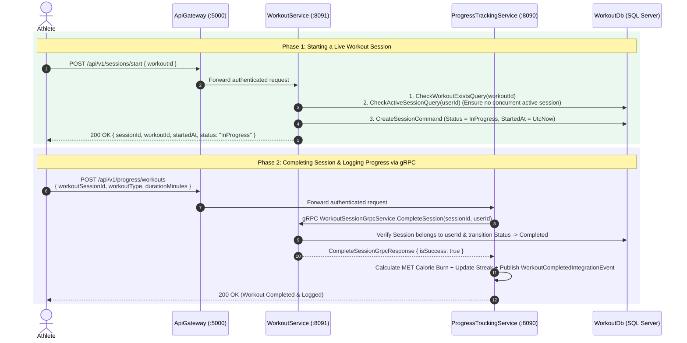
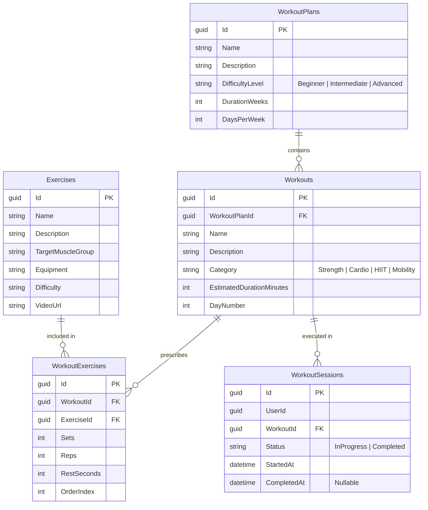

<div align="center">


# WorkoutService — Training Plans, Exercise Catalog & Live Session Engine

**Structured Training Prescription & Real-Time Workout Session Microservice Built with .NET 9, Vertical Slice Architecture, CQRS + MediatR, EF Core 9, RS256 JWT Authentication, and gRPC Session Completion Server**

</div>

---

## 1. Overview & Core Responsibilities

`WorkoutService` (Port `:8091`) manages the physical training domain of NextRep, providing athletes with structured workout plans, an exercise biomechanics catalog, and a stateful live workout session tracker:

- **Multi-Week Workout Plans & Exercise Prescriptions:** Models structured training programs (`WorkoutPlans`), individual training days (`Workouts`), and ordered exercise prescriptions (`WorkoutExercises` with `Sets`, `Reps`, `RestSeconds`, and `OrderIndex`).
- **Live Workout Session State Machine (`Start` $\rightarrow$ `Complete`):** [`StartSessionOrchestratorHandler`](./Features/WorkoutSessions/Orchestrators/StartSession/StartSessionOrchestratorHandler.cs) enforces business invariants inside `IUnitOfWork` — verifying that the target workout exists and preventing a user from starting overlapping active sessions before creating an `InProgress` `WorkoutSession`.
- **High-Performance gRPC Server for Cross-Service Session Completion:** Exposes [`WorkoutSessionGrpcServiceImpl`](./GrpcServices/WorkoutSessionGrpcServiceImpl.cs) (`Protos/workout_session.proto`) so `ProgressTrackingService` can synchronously verify and transition an active workout session to `Completed` when logging workout calorie expenditure and updating workout streaks.
- **Automated Database Seeding:** Automatically migrates and seeds `WorkoutDb` on startup via [`WorkoutDbSeeder.cs`](./Data/WorkoutDbSeeder.cs) with foundational exercises, categories, and multi-week workout plans.

---

## 2. Live Workout Session & gRPC Integration Flow



---

## 3. Database Schema (`WorkoutDb`)



---

## 4. Complete REST & gRPC API Reference

### 4.1 REST Endpoints (All require `Authorization: Bearer <token>`)

| Controller | Method | Route | Description |
| :--- | :---: | :--- | :--- |
| **`WorkoutPlansController`** | `GET` | `/api/v1/workout-plans` | Lists all available structured workout plans. |
| **`WorkoutPlansController`** | `GET` | `/api/v1/workout-plans/{id}` | Retrieves a specific workout plan and its metadata by `id`. |
| **`WorkoutsController`** | `GET` | `/api/v1/workouts` | Lists workouts with optional query filtering and pagination. |
| **`WorkoutsController`** | `GET` | `/api/v1/workouts/{id}` | Returns a workout along with its ordered `WorkoutExerciseDto` list (`Sets`, `Reps`, `RestSeconds`). |
| **`WorkoutsController`** | `GET` | `/api/v1/workouts/by-plan/{planId}` | Lists all workouts scheduled inside a specific `WorkoutPlan`. |
| **`WorkoutsController`** | `GET` | `/api/v1/workouts/category/{categoryName}` | Filters workouts by training category (e.g., `Strength`, `Cardio`, `HIIT`). |
| **`ExercisesController`** | `GET` | `/api/v1/exercises` | Returns the full biomechanics exercise catalog. |
| **`ExercisesController`** | `GET` | `/api/v1/exercises/{id}` | Returns detailed instructions, target muscle group, and media for a single exercise. |
| **`WorkoutSessionsController`** | `POST` | `/api/v1/sessions/start` | Starts a new live `WorkoutSession` (`{ workoutId }`) after verifying no active session conflict exists. |
| **`WorkoutSessionsController`** | `POST` | `/api/v1/sessions/complete` | Marks an active `WorkoutSession` (`{ sessionId }`) as `Completed`. |

### 4.2 gRPC Server Contract (`Protos/workout_session.proto`)

```protobuf
service WorkoutSessionGrpcService {
  rpc CompleteSession (CompleteSessionGrpcRequest) returns (CompleteSessionGrpcResponse);
}
```

---

## 5. Feature Slice Directory Structure

```text
WorkoutService/
├── Common/                                  # ApiResponse, Result<T>, Error, ValidationBehavior
├── Controllers/                             # Exercises, WorkoutPlans, Workouts, WorkoutSessions Controllers
├── Data/                                    # ApplicationDbContext, UnitOfWork, GeneralRepo, Entities, Seeder
├── Features/
│   ├── Exercises/Queries/                   # GetExercises, GetExerciseById slices
│   ├── WorkoutPlans/Queries/                # GetWorkoutPlans, GetWorkoutPlanById slices
│   ├── Workouts/Queries/                    # GetWorkouts, GetWorkoutById, GetWorkoutsByPlan, GetWorkoutsByCategory
│   └── WorkoutSessions/
│       ├── Commands/                        # CreateSession, CompleteSession slices
│       ├── Orchestrators/StartSession/      # StartSessionOrchestrator (Workout existence + Active session guard)
│       └── Queries/                         # CheckActiveSession, CheckWorkoutExists slices
├── GrpcServices/
│   └── WorkoutSessionGrpcServiceImpl.cs     # gRPC server endpoint consumed by ProgressTrackingService
└── Protos/workout_session.proto
```
